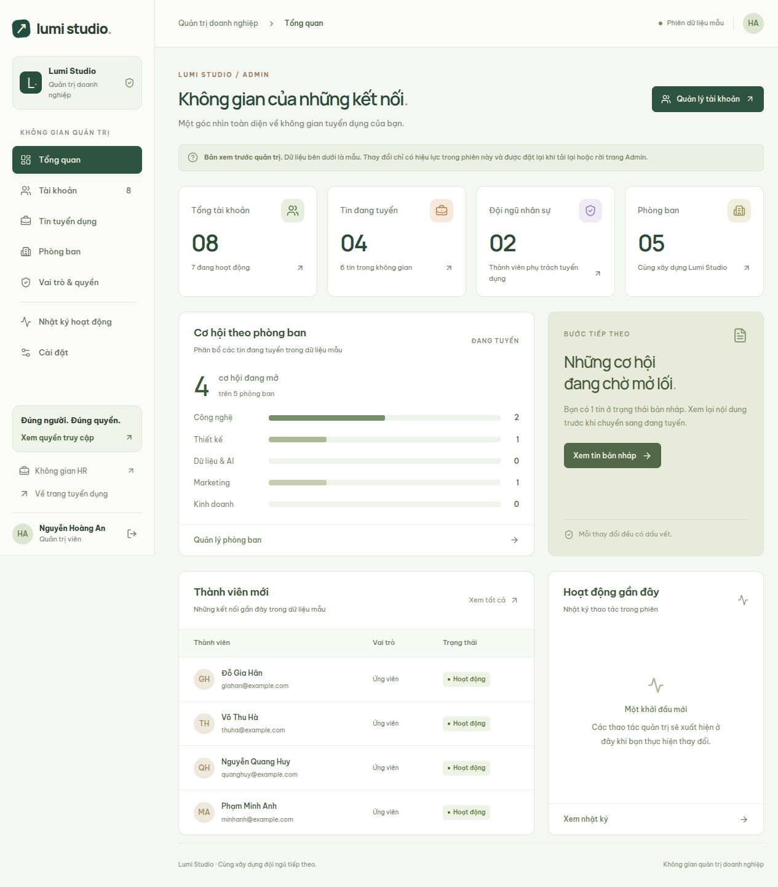
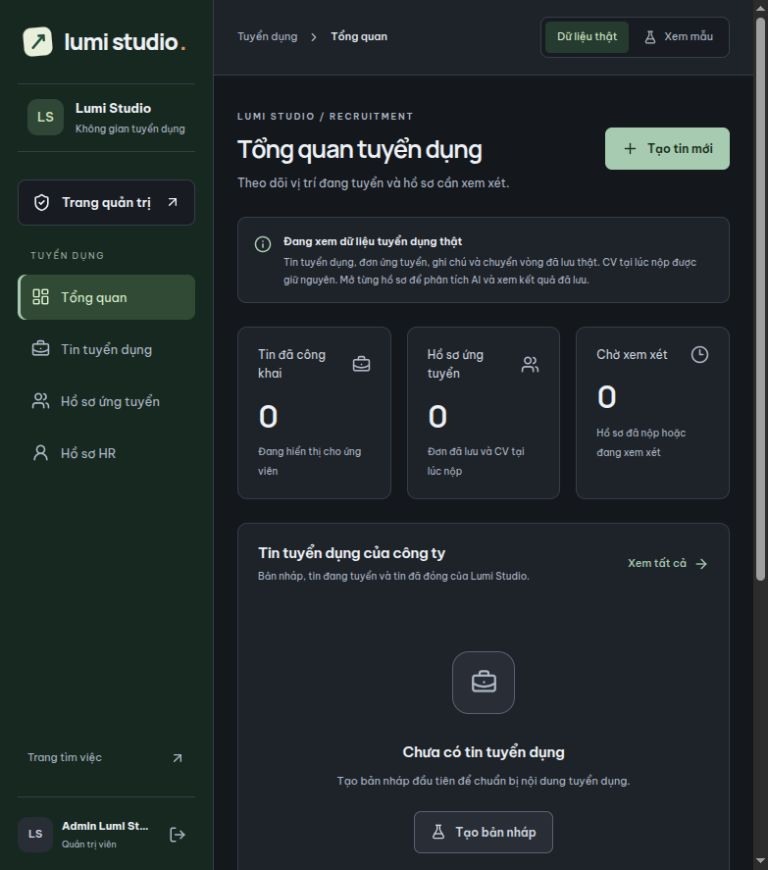
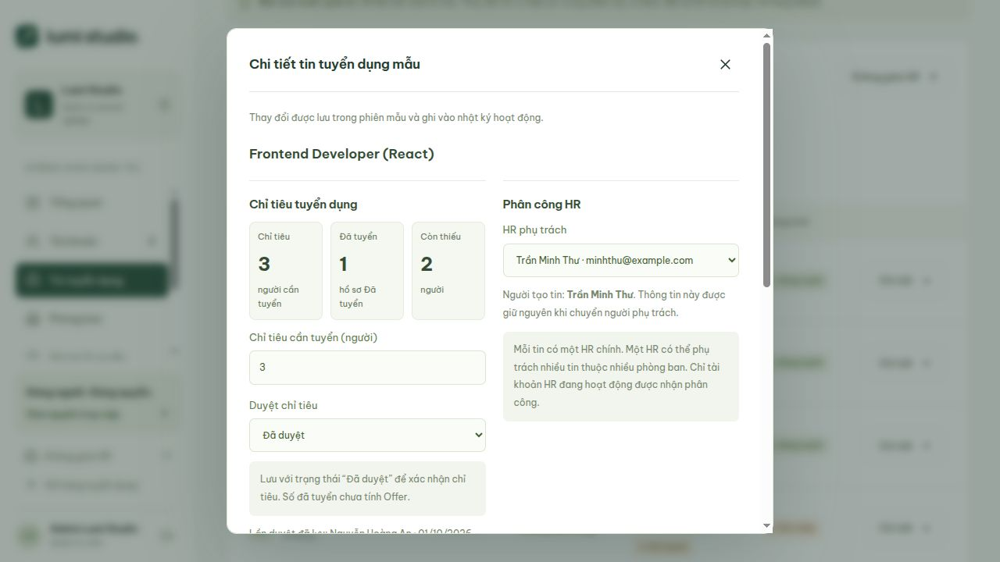

# Giao diện quản trị doanh nghiệp

## Truy cập

- `/admin` và các mục con chỉ cho phép `COMPANY_ADMIN` qua `ProtectedRoute`.
- Đăng nhập Admin luôn mở tổng quan quản trị `/admin`, kể cả khi trước đó truy cập đường dẫn HR hoặc mục Admin con. Từ đó Admin có thể chủ động chuyển sang không gian HR.
- HR (`RECRUITER`) tiếp tục vào `/recruiter`. Ứng viên bị chuyển về `/profile` khi mở trang Admin.
- Link trang quản trị có ở header/footer công khai. Trong không gian HR, link nằm đầu menu, phía trên các mục tuyển dụng và hiển thị cả trên điện thoại khi tài khoản là Admin.
- Không bổ sung đăng ký Admin, tài khoản hard-code hay thay đổi quyền trong localStorage.

## Các mục

| Đường dẫn | Nội dung |
| --- | --- |
| `/admin` | Tổng tài khoản, tin đang tuyển, số HR/phòng ban, biểu đồ phân bổ tin, thành viên mới, hoạt động gần đây |
| `/admin/users` | Tìm tên/email không dấu, lọc vai trò/trạng thái, phân trang; thêm/chỉnh sửa tài khoản mẫu |
| `/admin/jobs` | Tìm vị trí, lọc phòng ban/trạng thái/HR/duyệt chỉ tiêu, phân trang; chi tiết tin mẫu với chỉ tiêu và phân công HR |
| `/admin/departments` | Tìm, thêm/chỉnh sửa tên và mô tả phòng ban mẫu |
| `/admin/permissions` | Vai trò và bảng phạm vi truy cập đã khai báo trong ứng dụng |
| `/admin/activity` | Nhật ký thay đổi trong phiên, tìm kiếm, phân trang, xuất các kết quả đã lọc ra CSV UTF-8 |
| `/admin/settings` | Lưu thông tin doanh nghiệp trong phiên mẫu |

## Giới hạn dữ liệu

Xác thực dùng API hiện có. Nội dung quản trị dùng dữ liệu mẫu riêng ở `frontend/src/features/admin/admin-data.ts`. Không gọi API ghi và không sửa dữ liệu thật. Các thao tác mẫu không thay đổi quyền người đang đăng nhập, không gửi thư mời và không xuất bản tin tuyển dụng. Số liệu tổng quan được tính từ danh sách mẫu trong phiên.

Dữ liệu tồn tại khi chuyển giữa các mục Admin và đặt lại khi tải lại hoặc rời khu vực Admin. Nhật ký chỉ ghi các lần lưu thành công trong phiên; không phải nhật ký kiểm toán phía máy chủ. Để vận hành thật cần bổ sung API quản trị, kiểm tra quyền và lưu dữ liệu/nhật ký trên máy chủ.

## Các kiểm tra giao diện

- Phân trang danh sách tài khoản và tìm kiếm tiếng Việt không dấu.
- Báo email trùng không phân biệt hoa/thường; báo trùng tên phòng ban khi tìm không dấu.
- Không cho khóa/hạ quyền quản trị viên mẫu đang hoạt động cuối cùng.
- Chuyển tin bản nháp sang đang tuyển cập nhật danh sách, bộ lọc và thống kê mẫu.
- Lưu thành công tạo nhật ký; hủy hoặc dữ liệu không hợp lệ không tạo thay đổi.
- Các bảng dài cuộn ngang trong thẻ; không kéo rộng trang trên điện thoại.
- Menu điện thoại có lớp nền, đóng bằng Escape, giữ focus trong menu và trả focus khi đóng.
- Dialog chỉnh sửa dùng phần tử `dialog` chung với ứng dụng.
- Thông báo lưu dùng `role=status`; lỗi biểu mẫu dùng `role=alert`.

Kiểm tra trình duyệt dùng máy chủ phản hồi xác thực giả trong môi trường localhost riêng để kiểm tra từng vai trò; không cấp quyền hoặc chỉnh sửa tài khoản PostgreSQL. Kết quả kiểm tra thực tế được ghi khi hoàn tất triển khai.

## Kết quả xác minh ngày 04/10/2026

- Build TypeScript/Vite, lint và kiểm tra định dạng: đạt.
- Trình duyệt: phân trang, tìm không dấu, email/tên phòng ban trùng, bảo vệ Admin cuối, thêm tài khoản/phòng ban, đổi trạng thái tin, ghi nhật ký và lưu thông tin doanh nghiệp mẫu: đạt.
- Phân quyền giao diện với phản hồi xác thực giả: HR về `/recruiter`, ứng viên về `/profile`, chưa đăng nhập về `/login`, Admin đăng nhập về `/admin`.
- Bố cục điện thoại 390 px: không tràn ngang toàn trang; menu giữ focus, đóng bằng Escape và trả focus: đạt.
- Định dạng CSV được kiểm tra bằng trình đọc CSV độc lập: tiếng Việt, dấu phẩy/dấu nháy/xuống dòng, thời gian Việt Nam và dữ liệu bắt đầu bằng công thức: đạt. Việc lưu tệp tải xuống qua trình duyệt trong ứng dụng chưa xác minh được bằng sự kiện download.

## Cập nhật điều hướng ngày 10/10/2026

- Xác minh bằng tài khoản Admin thật: mở `/recruiter` khi chưa đăng nhập, đăng nhập thành công và được chuyển đến `/admin`.
- Từ Admin vào không gian HR: “Trang quản trị” nằm trên nhóm tuyển dụng; bấm vào trở lại tổng quan Admin.
- Kiểm tra màn hình 375 px: link quản trị vẫn nằm trên menu HR, không tràn ngang. Đã trả kích thước trình duyệt về mặc định và mở lại `/admin`.
- Build, lint, định dạng các tệp thay đổi và 4 tệp kiểm thử frontend: đạt.

## Chỉ tiêu và phân công HR (phiên mẫu)

- Tại **Tin tuyển dụng → Chi tiết**, Admin nhập số người cần tuyển, chọn chờ duyệt/đã duyệt, giao hoặc chuyển HR chính. Có thể bấm tên tin để mở chi tiết trên điện thoại mà không phải cuộn đến cột thao tác.
- Số đã tuyển tính từ ứng viên có hồ sơ `HIRED` đúng job trong tập hồ sơ mẫu `sampleJobApplications`; không tính `OFFER`, không nhập tay, không cộng hồ sơ job khác hoặc trùng ứng viên. Còn thiếu = max(0, chỉ tiêu − đã tuyển).
- Chỉ tiêu là số nguyên dương trong phạm vi PostgreSQL integer, không thấp hơn số đã tuyển. Đã đủ chỉ tiêu chỉ nhắc xem xét đóng tin; không tự đóng.
- Tin đăng/mở lại cần chỉ tiêu đã duyệt và HR phụ trách. Bản nháp có thể chờ duyệt/chưa phân công.
- Dropdown chỉ giao cho HR đang hoạt động; một HR được phụ trách nhiều tin thuộc nhiều phòng ban. Người tạo tin không thay đổi khi bàn giao. HR còn tin chưa đóng phải bàn giao trước khi khóa hoặc đổi vai trò trong danh sách mẫu.
- Thay đổi chỉ tiêu/trạng thái duyệt ghi lại người và ngày duyệt; chuyển về chờ duyệt xóa thông tin duyệt hiện hành. Nhật ký ghi riêng thay đổi chỉ tiêu và HR cũ → mới, chỉ sau khi lưu thành công.
- Đây là chức năng trong **phiên mẫu Admin**, đặt lại khi tải lại/rời Admin. Không cập nhật `recruitment.jobs.headcount`, không thay đổi quyền HR thật, không cập nhật tin/hồ sơ thật. Luồng duyệt, người phụ trách và nhật ký phía máy chủ chưa triển khai; cần API/database trước khi áp dụng các quy tắc này cho HR thật.

### Xác minh ngày 10/10/2026

- Trình duyệt với đăng nhập Admin thật, dữ liệu nghiệp vụ mẫu: điều chỉnh chỉ tiêu, chuyển HR, giữ người tạo, lưu người duyệt và nhật ký, lọc HR/chờ duyệt: đạt.
- Chặn đăng khi chưa duyệt hoặc chưa phân công; chặn giảm chỉ tiêu dưới số đã tuyển; nhắc đủ chỉ tiêu; chặn khóa HR còn tin: đạt.
- Điện thoại 375 px: trang rộng 360 px (trừ thanh cuộn), dialog không tràn ngang. Bảng cuộn trong thẻ. Đã bổ sung containing block cho nội dung hỗ trợ đọc màn hình trong bảng để không làm rộng trang.
- Build, lint, định dạng và 5 tệp kiểm thử frontend: đạt. Kiểm thử nghiệp vụ mới bao phủ tính số đã tuyển, chỉ tiêu hợp lệ, điều kiện đăng tin và ràng buộc bàn giao HR.

