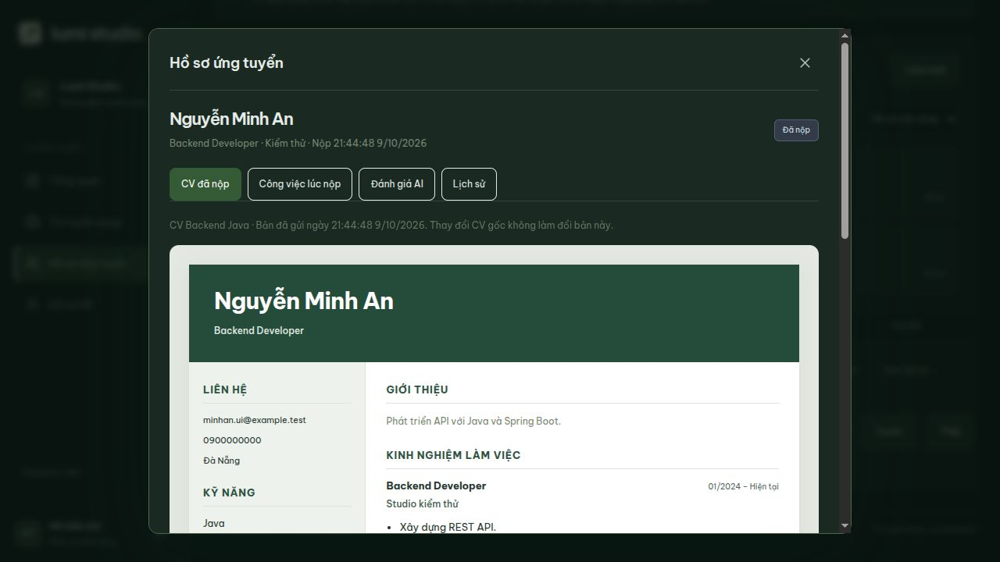

# Đơn ứng tuyển thật — V9, 09/10/2026

Đã hoàn thành đợt 1: ứng viên nộp bằng CV READY đã lưu → lưu đơn/snapshot/lịch sử ban đầu → ứng viên theo dõi → HR xem cùng hồ sơ ở danh sách tổng thể và trong từng job. Dữ liệu mẫu vẫn tách riêng, lỗi API không dùng mẫu thay thế.

## Database và quan hệ

Cả ba bảng nằm trong schema `recruitment`, tạo bởi `V9__applications_and_snapshots.sql`:

| Bảng | Nội dung |
| --- | --- |
| `applications` | UUID, job/candidate/resume FK, trạng thái, thư ứng tuyển, job version và JSONB snapshot JD, version đơn, applied/updated timestamp |
| `application_resume_snapshots` | PK/FK application_id (1–1), source_resume_version, schema_version=1, toàn bộ ResumeDto JSONB, captured_at |
| `application_status_history` | UUID, application FK, from/to status, actor FK auth.users, reason, created_at; khi nộp ghi SUBMITTED |

- `applications.job_id → recruitment.jobs.id`.
- `applications.candidate_id → candidate.candidate_profiles.user_id → auth.users.id`.
- FK `(resume_id,candidate_id) → candidate.resumes(id,candidate_id)` bảo vệ quyền sở hữu CV tại database; V9 thêm UNIQUE composite cho CV gốc.
- `UNIQUE(job_id,candidate_id)`: một đơn cho mỗi người/job, kể cả sau khi job mở lại. Chưa có luồng nộp lại/rút đơn.
- 7 trạng thái: SUBMITTED, REVIEWING, INTERVIEW, OFFER, HIRED, REJECTED, WITHDRAWN. V9 ghi trạng thái ban đầu SUBMITTED; [V10](hr-application-review.md) bổ sung thao tác chuyển vòng HR.
- Index theo candidate, job/vòng, CV và application/history; timestamp/version bắt buộc, version không âm, JSON phải là object, thư tối đa 10.000 ký tự.
- CV snapshot và lịch sử chỉ thêm, trigger chặn UPDATE/DELETE; trigger trên application chặn sửa danh tính, thư, JD snapshot/version và thời điểm nộp. Không cascade xóa đơn khi xóa CV/job.
- CV gốc đã dùng được sửa, nhưng xóa trả 409 với thông báo rõ; snapshot đã nộp giữ nguyên. Snapshot JD gồm nội dung, phòng ban, vị trí, lương, số lượng, hạn, kỹ năng required/optional, tiêu chí và trọng số.

Service dùng JPA cho job/CV và JDBC cho đơn JSONB, chung transaction qua cùng datasource. Khóa job trước, rồi department và profile ứng viên (cùng khóa profile với luồng sửa/xóa CV), đọc lại READY/version rồi ghi application + resume snapshot + initial history. JD snapshot nằm trong application. Tất cả commit cùng nhau; unique constraint bảo vệ bổ sung cho nộp trùng. Đóng tin hoặc sửa CV đồng thời cho kết quả theo thứ tự khóa, không trộn dữ liệu các phiên bản.

## API đã chạy

Mọi endpoint trả `ApiResponse`. GET list dùng `page` từ 0, size mặc định 20/tối đa 100; UI dùng 10. Dữ liệu list chỉ là phần tóm tắt, nội dung snapshot đầy đủ lấy ở endpoint detail.

| Endpoint | Kết quả |
| --- | --- |
| POST `/api/candidate/applications` | 201 + đơn/detail. Body `{jobId,resumeId,resumeVersion,coverLetter?}` |
| GET `/api/candidate/applications` | Phân trang đơn của chính ứng viên; lọc jobId/stage/search |
| GET `/api/candidate/applications/{id}` | Đơn của chính ứng viên, toàn bộ CV/JD snapshot và lịch sử trạng thái/thời gian |
| GET `/api/recruiter/applications` | Phân trang hồ sơ công ty Lumi; lọc jobId/stage/search tên/email/tên job tại lúc nộp |
| GET `/api/recruiter/applications/{id}` | Chi tiết đầy đủ snapshot của đơn |
| GET `/api/recruiter/applications/summary?jobId=...` | Tổng và 7 số đếm vòng + số đơn từng job; tính tất cả bản ghi, không chỉ một trang |

Actor/candidate lấy từ phiên. ACTIVE CANDIDATE chỉ nộp/đọc đơn của mình; ACTIVE RECRUITER/COMPANY_ADMIN đọc hồ sơ công ty, gồm tin đóng/hết hạn. Hiện chỉ một công ty; phải bổ sung company scope trước khi mở nhiều công ty. POST yêu cầu CSRF. Không nhận snapshot, status hoặc candidate ID do client gửi.

Nộp trả 409 khi trùng, CV DRAFT/version cũ, job không công khai/đã đóng/chưa tới publishedAt/hết hạn/department không hoạt động. CV không thuộc tài khoản trả 404. Chưa đăng nhập 401, sai role/thiếu CSRF 403. GET đơn của người khác trả 404. DTO lịch sử của ứng viên/detail cũ không lộ người thực hiện/lý do nội bộ; endpoint review HR và bảng ghi chú đã thêm ở [V10](hr-application-review.md).

## Giao diện và cách thử

1. HR vào **Dữ liệu thật → Tin tuyển dụng**, tạo/đăng một tin hợp lệ.
2. Ứng viên tạo CV và bấm **Hoàn tất CV**. Vào công việc → **Ứng tuyển**.
3. Chọn CV READY (CV mặc định được chọn sẵn), xem đủ CV, nhập thư tùy chọn → **Xác nhận gửi hồ sơ**.
4. Mở **Đơn ứng tuyển**, tải lại trang rồi bấm **Xem hồ sơ đã gửi**. Có CV, công việc lúc nộp và lịch sử SUBMITTED.
5. HR mở **Tin tuyển dụng → job → Ứng viên** hoặc **Hồ sơ ứng tuyển**. Bấm **Xem hồ sơ** để xem cùng snapshot.
6. Sửa CV gốc hoặc đóng/sửa JD: CV/JD trong đơn vẫn giữ bản lúc nộp. Xóa CV đã dùng bị chặn.

Không có CV READY: form dẫn sang tạo/hoàn tất CV và giữ `jobId` để quay lại đúng công việc. Chưa đăng nhập: đăng nhập rồi quay về job. CV DRAFT không xuất hiện trong lựa chọn. Khi gửi đang chạy, không gửi/đóng modal lần nữa; khi mất kết nối hoặc 409, UI đọc lại đơn của job để xác nhận trước khi cho gửi lại.

Danh sách ứng viên HR dùng chung API ở hai nơi; trong job khóa đúng job, tổng thể cho lọc lại công việc. Các ô vòng là số hồ sơ thật trước khi tìm tên/lọc vòng/phân trang. Job list/tổng quan đọc thống kê từ API; chưa tải/lỗi giữ “—”. Tab Tổng hợp AI hiển thị số hồ sơ thật và chưa phân tích; không xếp hạng giả.

**Cập nhật V10:** [Ghi chú, chuyển vòng và lịch sử HR](hr-application-review.md) đã lưu thật. Rút đơn, AI matching/% kỹ năng, upload/tải PDF CV và thông báo/lịch phỏng vấn chưa triển khai.

## Kiểm chứng

- Backend: 56 kiểm thử qua trên PostgreSQL riêng, không skipped. Gồm V8→V9 giữ nguyên dữ liệu cũ/rerun an toàn, Hibernate validate, quyền/CSRF/ownership, READY/version/job visibility, nộp trùng đồng thời, CV edit/job close cạnh tranh, rollback khi snapshot lỗi, snapshot bất biến và CV đã dùng không xóa, summary qua nhiều trang.
- Frontend: build/lint qua; hai suite kiểm thử formatter CV/model HR qua. Kiểm tra UI thực tế: ứng viên nộp → tải lại còn đơn → HR mở từ cả hai nơi; CV đủ các mục; desktop/mobile; trạng thái AI chưa phân tích rõ ràng; ứng viên chưa có CV tạo/hoàn tất CV rồi quay lại đúng job.
- Database đang dùng được sao lưu trước V9; Flyway áp dụng một migration và đối chiếu fingerprint dữ liệu cũ. Các job/CV/đơn thử chỉ nằm trong database thử riêng, sau kiểm tra dọn sạch.

