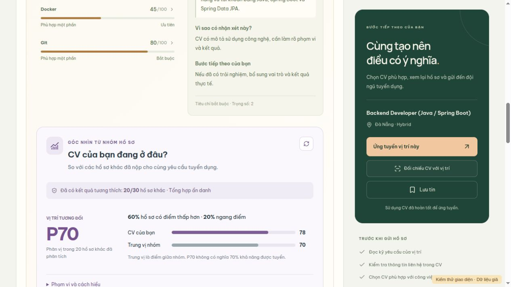
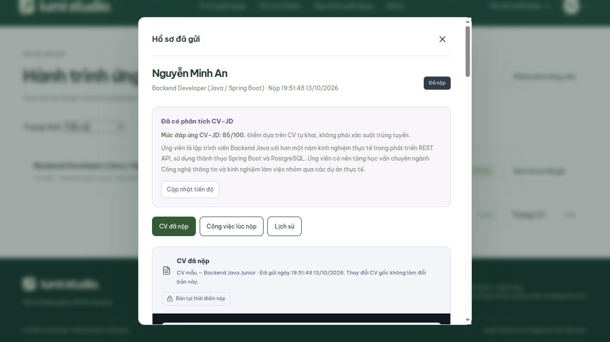

# Tự phân tích đơn và so sánh CV ẩn danh

Cập nhật 13/10/2026. Đã triển khai backend, PostgreSQL, worker và giao diện ứng viên. Điểm chỉ phản ánh mức đáp ứng thể hiện trong CV tự khai; không phải xác suất trúng tuyển hoặc năng lực đã xác minh.

## Luồng sử dụng

1. Ứng viên chọn CV hoàn tất để đối chiếu với job đang tuyển. Kết quả có căn cứ và điểm theo tiêu chí đã có trong luồng matching.
2. Ngay bên dưới xuất hiện **CV của bạn đang ở đâu?**: độ phủ dữ liệu, phân vị, trung vị tổng, so sánh từng kỹ năng và tối đa ba phần nên làm rõ. Nút cải thiện mở đúng CV/job trong CV Builder.
3. Chỉ hiển thị phân vị và thống kê chi tiết khi có ít nhất **10 ứng viên khác** có kết quả tương thích. Khi chưa đủ, hiện số đã phân tích/đang chờ, không tạo điểm nhóm giả.
4. Trước khi gửi đơn, form thông báo phần năng lực trong CV/JD sẽ được gửi tới Groq hoặc Gemini dự phòng. Họ tên, email, số điện thoại và các trường nhận diện ở gốc CV được loại khỏi input AI. Nội dung tự do vẫn do ứng viên cung cấp.
5. Nộp đơn ghi đơn, snapshot CV/JD, lịch sử và tác vụ AI trong cùng giao dịch. AI chạy nền; chậm/lỗi AI không khiến đơn đã lưu biến mất. Form và trang chi tiết đơn hiển thị tiến độ, điểm và tóm tắt của chính ứng viên.
6. Kết quả xuất hiện trong bảng đánh giá hiện có của HR. AI không tự loại/tuyển ứng viên hoặc đổi trạng thái đơn.

## Cách tính và giới hạn

- Mỗi ứng viên khác chỉ có một đơn cho job; mỗi đơn chỉ lấy đánh giá mới nhất. Loại đơn đã rút, tài khoản không hoạt động và chính ứng viên đang xem.
- Nhóm so sánh phải có cùng hash nội dung JD, model, prompt `v3` và quy tắc `evidence-fit-v3`. Đổi yêu cầu hoặc trọng số JD sẽ tạo nhóm khác; kết quả từ các model dự phòng khác nhau không trộn với nhau.
- Phân vị: `100 × (số điểm thấp hơn + 0.5 × số đồng điểm) / số hồ sơ khác tương thích`, làm tròn một chữ số. Tất cả đồng điểm cho P50.
- Trung vị tổng lấy từ nhóm trên. Trung vị từng tiêu chí chỉ lấy hồ sơ có bằng chứng, và chỉ hiện khi có ít nhất **5** hồ sơ có bằng chứng cho tiêu chí đó. `NO_EVIDENCE` không bị diễn giải thành kỹ năng bằng 0.
- Gợi ý ưu tiên tiêu chí bắt buộc thiếu căn cứ, sau đó khoảng thiếu nhân trọng số. Đây là lời nhắc bổ sung trải nghiệm có thật hoặc thực hành thêm; không bịa trải nghiệm và chưa phải roadmap theo dõi tiến độ.
- Tất cả trọng số bằng 0: trả `UNWEIGHTED`, không cung cấp phân vị vô nghĩa.
- Endpoint không trả tên/email/CV/điểm riêng của người khác. Ngưỡng mẫu giúp hạn chế lộ dữ liệu; chưa phải bảo đảm riêng tư vi sai hay hệ thống xác suất tuyển dụng đã hiệu chuẩn.
- So sánh và cập nhật thống kê dùng SQL, không gọi AI thêm. CV/JD thay đổi làm cache đối chiếu cũ mất hiệu lực.

## Database

Migration **V19** đã áp dụng trên database local, giữ nguyên snapshot và lịch sử đánh giá cũ.

| Bảng trong schema `recruitment` | Bổ sung / vai trò |
|---|---|
| `applications` | `ai_job_context_hash` ghi ngữ cảnh JD tại thời điểm nộp. |
| `candidate_job_matches` | `assessment_payload`, `job_context_hash`, `input_hash`, `evaluation_version`: giữ phản hồi đã kiểm chứng để dùng lại khi nộp cùng CV/JD, gồm câu hỏi phỏng vấn cho HR. Cache hiện tại `candidate-match-v4`. |
| `ai_assessments` | Hash input/JD và phiên bản đánh giá; mở rộng model_name 100 ký tự. Mỗi lần đánh giá vẫn tạo bản ghi lịch sử riêng. |
| `ai_assessment_criteria` | Dùng bảng hiện có lưu điểm/trọng số/căn cứ từng tiêu chí. |
| `ai_analysis_tasks` | Hàng đợi bền vững, unique FK `application_id`; trạng thái, lần thử, thời gian thử tiếp, token/hạn lease, FK kết quả, mã lỗi an toàn và timestamps. |

Không cần lưu bảng xếp hạng hoặc sao chép CV người khác cho ứng viên. Thống kê được tính từ kết quả đã lưu trong một snapshot SQL nhất quán. Không tự tạo tác vụ phân tích hàng loạt cho đơn lịch sử; các đơn này hiển thị `NOT_REQUESTED`, HR vẫn có thể phân tích bằng thao tác hiện có.

## Worker và tính ổn định

- Poll mặc định 3 giây, khởi động trễ 10 giây, tối đa hai tác vụ đồng thời trong một backend. PostgreSQL `SKIP LOCKED` hỗ trợ nhiều worker không lấy cùng một hàng.
- Lease mặc định tối thiểu 120 giây hoặc timeout AI cộng 30 giây. Tiến trình dừng được phục hồi sau khi lease hết; token ngăn worker cũ ghi đè lỗi của lượt mới.
- Mặc định tối đa ba lần thử; lần lỗi đầu chờ 15 giây, tiếp theo 60 giây. Hết lượt thành `FAILED`. Bận/khóa đồng thời chờ 30 giây, không tính như một lượt gọi trả phí thất bại.
- Advisory lock theo đơn phối hợp với thao tác HR. Dùng lại đánh giá/đối chiếu hợp lệ trước khi gọi provider; input là snapshot bất biến của đơn, không lấy CV đã sửa sau khi nộp.
- Đầu ra phải khớp đủ ID/tên/trọng số tiêu chí, quote nguyên văn từ một giá trị CV, tổng điểm tính lại và metadata hợp lệ. Lỗi provider/validation không tạo kết quả giả.
- Dừng tác vụ chưa xử lý nếu đơn đã rút hoặc tài khoản không hoạt động. Không ghi body CV, API key hoặc raw provider error vào bảng tác vụ.
- Có thể cấu hình `app.ai-analysis.worker-enabled`, `poll-delay-ms`, `initial-delay-ms`, `max-attempts` (1–5), `minimum-benchmark-peers` (không dưới 10). Tắt worker vẫn lưu tác vụ chờ cho lần bật lại.

## API

| API | Hành vi |
|---|---|
| `POST /api/candidate/applications` | Hợp đồng nộp đơn giữ nguyên; thêm enqueue nguyên tử. Vẫn kiểm tra CSRF, READY, chủ sở hữu, phiên bản, hạn và trùng đơn. |
| `GET /api/candidate/applications/{id}/ai-status` | Chỉ chủ đơn đang hoạt động; `state`, attempts/maxAttempts, nextAttemptAt, điểm/tóm tắt/thời điểm của chính mình khi hoàn tất. |
| `GET /api/candidate/jobs/{jobId}/benchmark?resumeId=…` | Chỉ CV READY của chính mình và job công khai. Trả `READY`, `INSUFFICIENT_DATA`, `NEEDS_MATCH` hoặc `UNWEIGHTED`; thống kê tổng hợp, không gọi provider. |

Cả hai GET cá nhân đặt `Cache-Control: no-store`. Giao diện cập nhật tiến độ 5 giây khi đang chờ; thống kê 15 giây khi phần kết quả mở và tab được nhìn thấy. Nút cập nhật chỉ đọc lại dữ liệu.

## Nghiệm thu

- **28 integration tests PostgreSQL** trên database riêng qua: enqueue nguyên tử, tái sử dụng kết quả không gọi AI, worker dispatch, lỗi provider/retry tối đa, phục hồi lease/worker cũ, đơn rút, ngưỡng 9/10, đồng điểm P50, trung vị kỹ năng bị ẩn dưới 5 mẫu, đánh giá mới không đếm đôi, khác model/JD, quyền sở hữu/khách, cùng các luồng HR/matching/nộp đơn/CV liên quan.
- **42 Python tests**, **18 tệp kiểm thử frontend** qua; build thành công, lint chỉ còn cảnh báo có sẵn ở TopCandidatesWidget.
- UI trạng thái đủ/chưa đủ dữ liệu đã kiểm tra bằng fixture có nhãn **Dữ liệu giả**. Màn hình 390px không tràn ngang; viewport trả về mặc định.
- Hệ thống local thật: Gemini dự phòng trả 85/100 cho CV giả Backend Java Junior, 8 tiêu chí. Nộp CV giả → tác vụ `COMPLETED` sau 1 lần claim, điểm 85, đơn vẫn `SUBMITTED`. Log AI chỉ có **một** request assess cho lượt matching; khi nộp không gọi thêm provider.
- Job local chưa có hồ sơ khác tương thích: benchmark thật trả `INSUFFICIENT_DATA`, 0 peers, percentile null, criteria rỗng. Ba server 5173/8080/8000 hoạt động.
- Hồ sơ kiểm thử thật mang thư giới thiệu ghi rõ **hồ sơ giả kiểm thử tự động AI**, không phải ứng viên thực tế. Không tạo thêm ứng viên giả để ép đủ ngưỡng trên database demo.

