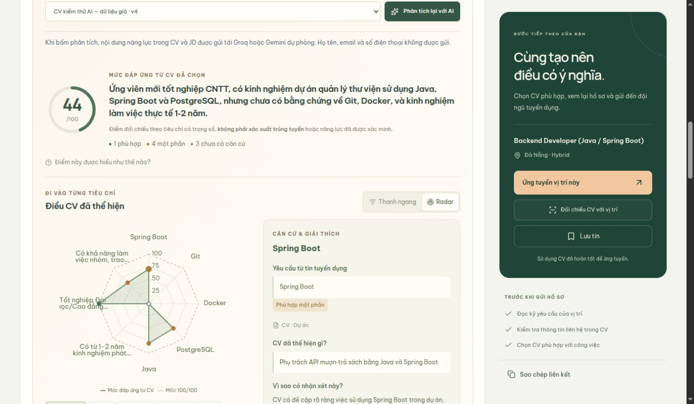
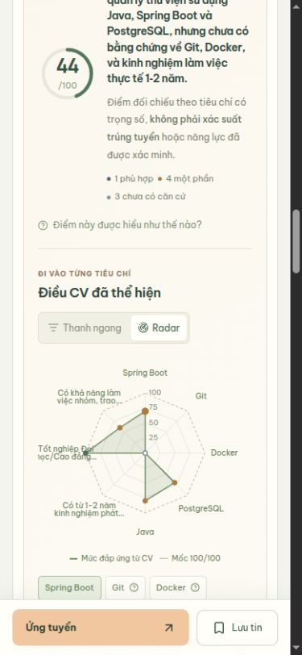

# AI ứng viên: đối chiếu → cải thiện CV → đối chiếu lại → ứng tuyển

Cập nhật 13/10/2026. Đây là tính năng chạy API thật trước khi ứng tuyển, tách biệt với đánh giá đơn đã nộp của HR.

Đã bổ sung [tự phân tích đơn và so sánh CV ẩn danh](candidate-ai-benchmark.md): migration V19, prompt `v3`, cache `candidate-match-v4`. Matching và đánh giá đơn dùng chung hợp đồng/kiểm chứng; khi nộp cùng CV/JD có thể dùng lại kết quả đã lưu, không gọi AI lần nữa. Benchmark chỉ hiện thống kê khi đủ ít nhất 10 hồ sơ khác tương thích. Các số liệu nghiệm thu bên dưới ghi nhận lượt triển khai matching trước; kết quả mới nằm trong tài liệu bổ sung.

## Trải nghiệm

1. Mở tin đang tuyển, mở “CV của bạn phù hợp đến đâu?”, chọn một CV READY thuộc tài khoản.
2. Hệ thống mở kết quả đã lưu nếu đúng nội dung/phiên bản. Chỉ gọi AI khi ứng viên yêu cầu và chưa có cache phù hợp.
3. Xem vòng điểm tổng, thanh ngang hoặc radar, các tiêu chí bắt buộc/ưu tiên, nguồn và trích dẫn CV, yêu cầu JD, lý do và gợi ý.
4. Bấm “Cải thiện CV cho vị trí này”: mở đúng CV với jobId trong CV Builder. Trợ lý rà soát hỏi thông tin thực tế, ứng viên duyệt đề xuất trước/sau và chủ động áp dụng/hoàn tác.
5. Hoàn tất và lưu CV. “Đối chiếu CV đã lưu” đưa về đúng tin và CV. Kết quả của phiên bản cũ không được dùng; bấm phân tích để đánh giá bản mới.
6. “Tiếp tục ứng tuyển” chọn sẵn đúng CV trong form nộp đơn. API vẫn kiểm tra quyền sở hữu, trạng thái READY và phiên bản tại thời điểm nộp.

Không tự tạo đơn, tự sửa CV, tự thêm kỹ năng hoặc tự khẳng định năng lực đã được xác minh. Điểm thể hiện mức đáp ứng được ghi nhận trong CV, không phải xác suất trúng tuyển. NO_EVIDENCE hiển thị “Chưa có bằng chứng”, không giả thành mức kỹ năng 0. Nếu toàn bộ trọng số bằng 0, giao diện không hiển thị điểm tổng có ý nghĩa.

## API và dữ liệu

- `GET /api/candidate/jobs/{jobId}/match?resumeId=…`: trả cache hiện hành hoặc null, không gọi provider.
- `POST /api/candidate/jobs/{jobId}/match`: `{resumeId, force?: false}`. Mặc định dùng cache; force chỉ được phép sau ít nhất 30 giây với kết quả hiện hành.
- Chỉ CANDIDATE đang hoạt động, CV READY của chính mình và tin PUBLISHED chưa hết hạn/phòng ban hoạt động. POST yêu cầu CSRF. Kết quả cá nhân dùng `Cache-Control: no-store`.
- Bảng `recruitment.candidate_job_matches`, khóa `(candidate_id, job_id, resume_id)`. Migration V18 thêm `source_hash`, `prompt_version`, `model_name` mà không xóa dữ liệu cũ. Cache cũ thiếu hash tự bị bỏ qua.
- SHA-256 bao gồm CV/nội dung và phiên bản JD, các liên kết kỹ năng, tên trong catalog, required, tiêu chí, loại và trọng số. Đổi bảng con/catalog cũng vô hiệu cache dù job.version không đổi.
- Một câu SQL chụp dữ liệu CV/JD nhất quán; đọc lại sau khi AI trả về. CV/JD thay đổi trong lúc chạy: HTTP409, không lưu kết quả cũ.
- Lỗi lưu database làm request thất bại, không báo đã lưu giả. Trạng thái/đơn ứng tuyển và CV không bị thay đổi khi đối chiếu.

## Độ tin cậy và giới hạn gọi AI

- Matching và tóm tắt JD dùng Groq → Gemini, một lần mỗi provider; tối đa 28 giây cho lượt AI. Timeout Java/local là 60 giây; frontend matching 65 giây và summary 45 giây. Không có vòng retry vô hạn.
- Cooldown 15–300 giây theo provider/model khi lỗi/quota. Tối đa hai yêu cầu grounded AI đồng thời tại Python; Java matching tối đa hai và advisory lock theo ứng viên ngăn gửi nhiều job cùng lúc.
- Phản hồi sai cấu trúc/điểm/trọng số/trích dẫn sẽ thử provider dự phòng. Nếu Groq trả json_validate_failed kèm candidate JSON, hệ thống chỉ sử dụng candidate sau cùng một bộ kiểm tra nghiệp vụ/trích dẫn; không tạo thêm request và không chấp nhận quote giả. Refusal không bị vượt qua bằng provider khác. Nếu cả hai lỗi, báo thử lại; không sinh điểm/tóm tắt giả.
- Tiêu chí phải khớp chính xác ID/tên/trọng số do HR lưu. Điểm tổng được tính lại theo trọng số ở Python và kiểm tra lại ở Java.
- Quote phải là đoạn nguyên văn từ một giá trị CV, không được ghép trường học/bằng cấp/chuyên ngành thành câu trích dẫn mới. Schema đầu ra cung cấp các lựa chọn quote có thật và tên gap thuộc JD; server vẫn xác minh lại.
- Yêu cầu đích của gap được lấy từ tên tiêu chí JD, không chấp nhận mức seniority/thành thạo do AI tự thêm. Roadmap là gợi ý bước đầu, chưa phải kế hoạch học có tiến độ.
- Họ tên/email/điện thoại/LinkedIn không được gửi từ endpoint matching. Phần năng lực và các liên kết nghề nghiệp được gửi khi yêu cầu. JD/CV là dữ liệu, không phải chỉ dẫn. Không mở GitHub/URL để xác minh.
- Logs chỉ giữ mã lỗi/model/provider và request ID; không in CV, response body hoặc API key.

Thông tin cấu trúc phản hồi Gemini tham khảo [tài liệu Google về structured outputs](https://ai.google.dev/gemini-api/docs/generate-content/structured-output?hl=en). Mỗi phản hồi vẫn cần kiểm tra nghiệp vụ và căn cứ tại server.

## Kiểm thử

- PostgreSQL database riêng: cache bền vững, không tạo đơn/sửa CV, riêng tư/CSRF/quyền sở hữu, CV DRAFT/tin đóng, lỗi provider/timeout/trích dẫn giả, thay đổi CV/JD/catalog, request đồng thời và CV đổi trong lúc AI xử lý.
- Python: schema/camelCase, đầy đủ tiêu chí/trọng số, tính điểm, quote giả hoặc ghép, quota/timeout, provider fallback, refusal, JSON lỗi, request transport và cấu hình schema cho cả hai provider.
- Frontend: phép tính/không có bằng chứng, gắn đúng job/CV/phiên bản, đường đi sửa/quay về, build/lint.

Cấu hình local đã đổi Gemini dự phòng sang gemini-3.1-flash-lite sau khi model cũ nhiều lần timeout/503; model nhẹ đã trả đúng JSON trong thử nghiệm trực tiếp.

Provider bên ngoài vẫn có thể hết quota hoặc gián đoạn. Fallback/cache làm giảm ảnh hưởng, không đảm bảo luôn có kết quả. Đây là đánh giá nội dung tự khai, chưa có xác minh năng lực qua phỏng vấn/bài test/GitHub.

### Kết quả nghiệm thu cục bộ

- 31 integration tests PostgreSQL qua, 0 lỗi/skip; gồm 5 test matching mới và 4 test summary, cùng các luồng CV/ứng tuyển/AI CV hiện có.
- 42 Python tests qua. 17 tệp kiểm thử frontend qua; build thành công, lint chỉ còn cảnh báo có sẵn tại TopCandidatesWidget.
- Groq và Gemini flash-lite đều trả kết quả hợp lệ cho CV giả nhiều tiêu chí.
- Trình duyệt đã chạy: matching thật → mở đúng CV/job → AI rà soát/hỏi → soạn giới thiệu → áp dụng → hoàn tất/lưu → quay về CV v4 (cache v3 không hiện) → đánh giá lại → form ứng tuyển chọn đúng CV và nội dung mới. Không nộp hồ sơ giả vào job đang demo.
- AI summary thật hoạt động, có căn cứ JD. Desktop/radar và mobile 390px đã kiểm tra, không tràn ngang; viewport đã trả về mặc định.

