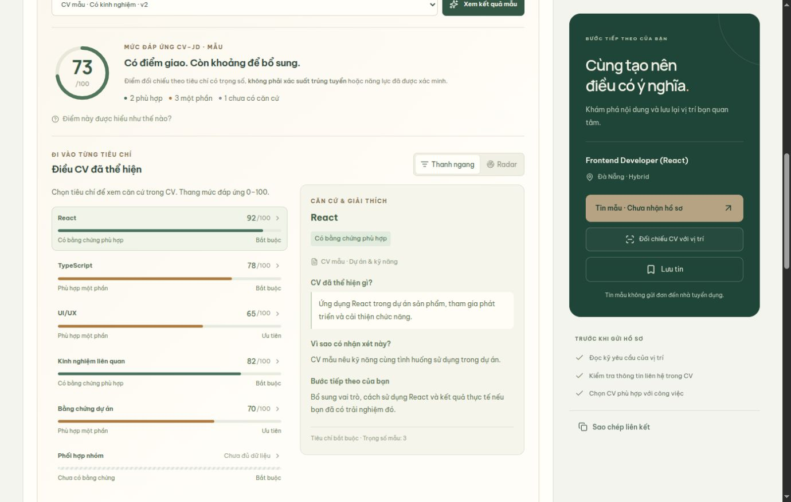
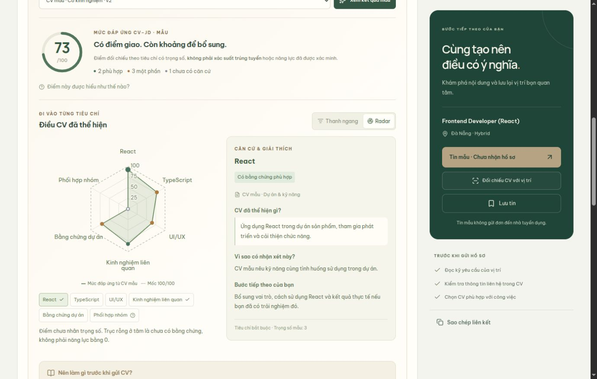
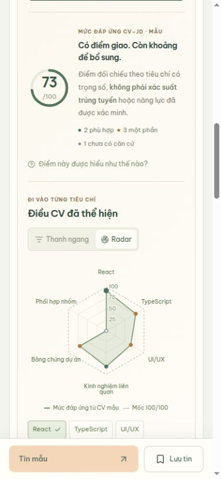

# Giao diện đối chiếu CV–JD của ứng viên

## Bố trí trong trang chi tiết công việc

- Khối “CV của bạn phù hợp đến đâu?” ở đầu cột nội dung, trước mô tả JD. Mặc định thu gọn để ứng viên vẫn đọc và ứng tuyển bình thường.
- Nút “Đối chiếu CV với vị trí” nằm dưới nút ứng tuyển ở cột bên phải; bấm sẽ mở và chuyển tới khối đối chiếu. Đây là nội dung trong trang, không phải modal.
- “Hiểu nhanh vị trí với AI” tóm tắt tin tuyển dụng cho mọi người; khối đối chiếu trả lời câu hỏi cá nhân về CV đã chọn.
- Mở khối → chọn một phiên bản CV → yêu cầu phân tích → xem điểm, căn cứ và gợi ý. Đổi CV xóa kết quả cũ ngay.

## Biểu đồ

1. **Vòng điểm tổng /100** giúp đọc nhanh mức đáp ứng được ghi nhận trong CV. Điểm không thể hiện xác suất trúng tuyển hay năng lực đã được kiểm chứng.
2. **Thanh ngang từng tiêu chí**, mặc định: cùng thang 0–100, có trạng thái, mức bắt buộc/ưu tiên, bấm được để xem căn cứ. Tiêu chí chưa có bằng chứng được ghi “Chưa đủ dữ liệu”, không giả thành điểm kỹ năng 0.
3. **Radar**, thay thế thanh ngang khi chuyển chế độ: nhìn tổng thể hồ sơ theo tiêu chí, có mốc 100, các mức 25/50/75 và nhóm trục tối đa 8. Radar cần ít nhất 3 trục; có nút chọn tiêu chí bằng bàn phím. Trục không có bằng chứng đánh dấu rỗng ở tâm và giải thích rõ ý nghĩa.

Chỉ có hai biểu đồ cùng hiển thị: vòng điểm và thanh ngang **hoặc** radar. Không thêm biểu đồ tròn phân bổ kỹ năng vì các kỹ năng không phải những phần của một tổng.

Căn cứ đi cùng biểu đồ: phần CV được tham chiếu, trích dẫn, lý do đánh giá, bước bổ sung và trọng số. Gợi ý chỉ yêu cầu mô tả trải nghiệm thật, không hướng dẫn bịa nội dung. Trên màn hình nhỏ, biểu đồ và căn cứ xếp thành một cột.

## Phạm vi đã triển khai

Đã nối API thật và cache PostgreSQL. Xem [luồng AI CV–job hoàn chỉnh](candidate-ai-matching.md) để biết API, điều kiện truy cập, kiểm chứng bằng chứng, dự phòng nhà cung cấp và cách quay lại sửa CV.

- Tin mẫu vẫn có nhãn minh họa, không dùng CV thật hoặc gửi AI.
- Tin thật: ứng viên chọn CV READY của chính mình, tải cache đúng phiên bản, chủ động phân tích và xem kết quả thật.
- Kết quả có căn cứ CV/JD và gợi ý theo tiêu chí. Có nút mở đúng CV Builder kèm job và quay về đánh giá bản vừa lưu.
- Nút tiếp tục ứng tuyển chuyển đúng CV đã chọn; API nộp đơn vẫn kiểm tra lại phiên bản/quyền sở hữu.
- Lỗi AI không chặn đọc JD, sửa CV hoặc nộp đơn bình thường; không tạo điểm giả.

## Kiểm tra

- Kiểm tra trực tiếp trên trình duyệt: mở từ sidebar, hai CV mẫu, chuyển thanh ngang/radar, chọn tiêu chí, chưa có bằng chứng, đổi CV xóa kết quả cũ.
- Kiểm tra chiều rộng điện thoại 390px, xếp một cột, không tràn ngang.
- Kiểm tra các trạng thái dữ liệu thật bằng máy chủ fixture cục bộ tách biệt: khách, CV hoàn tất/mặc định, đổi CV, CV bản nháp, chưa có CV, lỗi/thử lại và tài khoản HR. Không thêm tài khoản hoặc CV vào database.
- Có kiểm tra tự động cho phép tính trình bày điểm, trường hợp chưa có bằng chứng, dữ liệu mẫu và tính độc lập giữa hai CV.
- `npm run build` thành công; `npm test` qua 14/14 tệp kiểm tra. `npm run lint` thành công, còn cảnh báo sẵn có ở `TopCandidatesWidget.tsx` về cập nhật state trong effect; các tệp mới không có cảnh báo lint.

