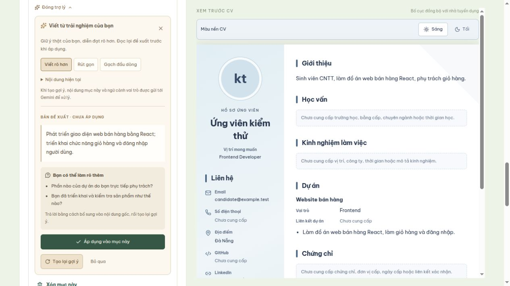
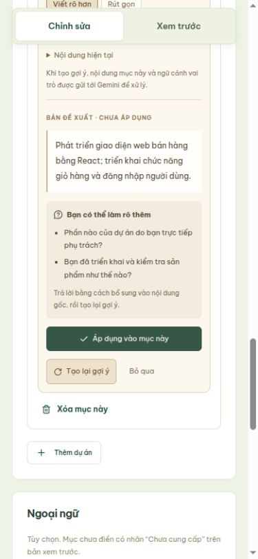
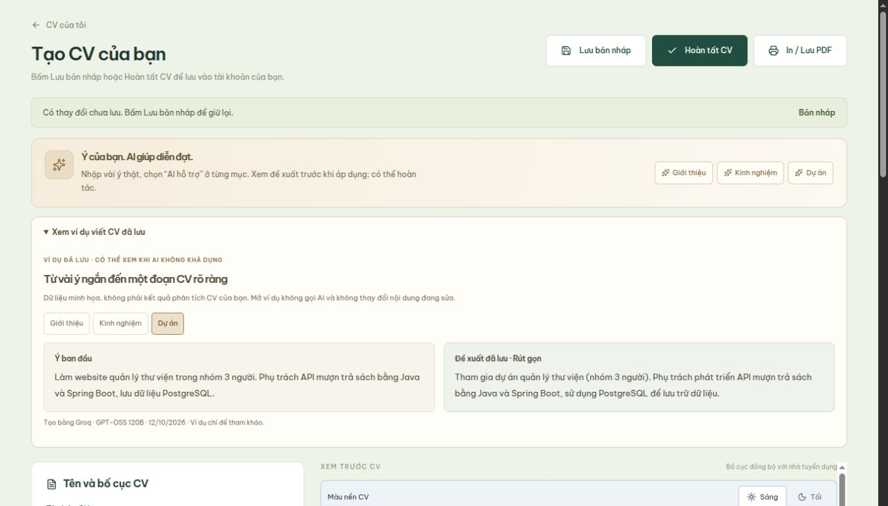

# Trợ lý viết CV trong trình tạo CV

Ngày cập nhật: 12/10/2026.

## Giao diện và luồng sử dụng

Giữ nguyên `/cv-builder`, form nhập liệu, lưu nháp/hoàn tất và preview dùng chung với HR.
Banner “Sắp có” được thay bằng thanh “Ý của bạn. AI giúp diễn đạt.”, có liên kết tới
Giới thiệu, Kinh nghiệm và Dự án. Cột nhập rộng 420px trên desktop để đủ chỗ đọc đề xuất.
Điện thoại vẫn dùng hai tab Chỉnh sửa / Xem trước; thanh công cụ chuyển đúng về mục đang sửa.

Mỗi phần Giới thiệu và mỗi mô tả Kinh nghiệm/Dự án có nút **AI hỗ trợ**:

1. Nhập vài ý thật vào nội dung gốc. Khi còn trống, trợ lý đưa câu hỏi hướng dẫn, không tự tạo kinh nghiệm.
2. Chọn Viết rõ hơn / Rút gọn / Gạch đầu dòng rồi Tạo gợi ý.
3. Hiện bản đề xuất “Chưa áp dụng” và tối đa ba câu hỏi làm rõ. Nội dung gốc và preview chưa đổi.
4. Áp dụng mới thay đúng mục đó, cập nhật preview và đánh dấu thay đổi chưa lưu.
5. Hoàn tác AI phục hồi nội dung trước khi áp dụng. Sau khi người dùng sửa tay hoặc đổi ngữ cảnh, hoàn tác cũ không còn được phép ghi đè.

Sửa nội dung, vai trò hoặc chế độ viết khiến đề xuất cũ không áp dụng được; cần tạo lại.
Đóng trợ lý bỏ đề xuất và bỏ qua phản hồi đến muộn. Các entry có khóa giao diện ổn định;
xóa một dự án không chuyển đề xuất sang dự án khác. Lưu CV vẫn là thao tác riêng của người dùng.

## API và dữ liệu

- Frontend: `POST /api/candidate/cv-writing` với `{section, action, text, context}`.
- `section`: summary / experience / project; `action`: polish / shorten / bullets.
- Chỉ gửi nội dung mục đã chọn (1–6000 ký tự) và ngữ cảnh tên dự án/công ty/vai trò (tối đa 1000 ký tự), không tự gửi toàn CV hay thông tin liên hệ.
- Backend kiểm tra tài khoản ACTIVE, role CANDIDATE, CSRF và giới hạn dữ liệu. Mỗi tài khoản tối đa một yêu cầu đang xử lý; tối đa hai yêu cầu toàn dịch vụ.
- Java gọi `POST /api/cv-writing` trên dịch vụ Python; kết quả gồm suggestion, questions, model_name, prompt_version.
- Không có bảng mới, không tự ghi database, không tạo CV chỉ vì nhờ AI. Khi Áp dụng rồi Lưu, dùng API CV và các trường summary/experiences/projects hiện có.
- Phản hồi không cache; không ghi nội dung CV, prompt hay phản hồi nhà cung cấp vào log.
- Groq tối đa 10 giây, Gemini dự phòng tối đa 12 giây; tổng xử lý Python tối đa 24 giây, Java 30 giây, frontend 45 giây. Mỗi dịch vụ chỉ được gọi một lần trong một yêu cầu. Lỗi hoặc timeout giữ nguyên nội dung và cho thử lại.

Prompt coi văn bản CV là dữ liệu không đáng tin cậy, không làm theo chỉ dẫn bên trong.
AI chỉ được diễn đạt lại sự kiện trong nội dung gốc; ngữ cảnh không được biến thành kinh nghiệm.
Python và Java từ chối đầu ra sai cấu trúc/giới hạn, số liệu hoặc URL mới không có trong nguồn.
Đây là kiểm tra có giới hạn, không chứng minh mọi câu đều đúng về ngữ nghĩa; ứng viên cần đọc lại trước khi áp dụng.

## Cấu hình và phạm vi

CV writing dùng **Groq → Gemini**. Cấu hình server trong `ai-service/.env` hoặc biến môi trường:

```env
GROQ_API_KEY=PASTE_YOUR_KEY_HERE
GROQ_MODEL=openai/gpt-oss-120b
GEMINI_API_KEY=PASTE_YOUR_KEY_HERE
GEMINI_MODEL=gemini-3.8-flash
```

Các tính năng AI khác vẫn dùng Gemini. Không đưa key vào frontend hoặc Git.
Cài dependency theo `requirements.txt` rồi khởi động lại Python để nhận cấu hình.
Cấu hình trả phí, nạp tiền và ngân sách nhà cung cấp không được tự thay đổi.

Groq trả JSON theo schema; Gemini trả JSON và được kiểm tra cùng quy tắc.
`model_name` có tiền tố nhà cung cấp, ví dụ `groq/openai/gpt-oss-120b`, do server gán.
Lỗi mạng, timeout, lỗi HTTP hoặc đầu ra không hợp lệ chuyển sang nhà cung cấp tiếp theo.
Thiếu key thì bỏ qua nhà cung cấp đó. Từ chối nội dung của mô hình không kích hoạt chuyển API.
API lỗi được tạm bỏ qua trong bộ nhớ tiến trình: 15–300 giây, có xét `Retry-After` dạng số;
lỗi key/quyền/model nghỉ 60 giây. Không lưu CV hay key vào trạng thái này.
Không gọi song song hai nhà cung cấp, không retry vô hạn, không thay lỗi bằng dữ liệu giả.
Giới hạn này không thay thế hạn mức hoặc ngân sách của tài khoản nhà cung cấp.

### Ví dụ lưu sẵn khi demo

Trong CV Builder, mở **Xem ví dụ viết CV đã lưu** dưới thanh AI. Ba ví dụ gồm
Giới thiệu, Kinh nghiệm và Dự án, dùng dữ liệu giả và kết quả Groq đã tạo trước.
Hiển thị rõ nguồn, ngày lưu và nhãn ví dụ; không gọi API, không có nút áp dụng vào CV.
Các ví dụ được chọn sau khi đọc lại kết quả. Không tự lưu/cache phản hồi của ứng viên thật.
Có thể xem khi API AI ngừng hoạt động, miễn giao diện ứng dụng đã tải được.

### Tập thử có kiểm soát

Chạy từ thư mục `ai-service`: `.venv/bin/python scripts/check_cv_writing.py 20`.
Đây là kiểm thử trực tiếp, **có dùng hạn mức API**; tối đa 20 lượt với dữ liệu giả,
nghỉ hai giây giữa lượt và dừng sau hai lỗi liên tiếp. Báo cáo ở
`/tmp/lumi-cv-rehearsal.json`; không dùng CV trong database và không xuất key.
Báo cáo chỉ xác nhận cấu trúc và các kiểm tra số liệu/liên kết, không chứng minh
mọi diễn đạt đều chính xác về ngữ nghĩa. Luôn đọc lại đề xuất trước khi áp dụng.

Hỏi đáp tạo toàn bộ CV, nhập PDF/DOCX, AI rà soát toàn bộ CV và viết theo JD chưa thuộc bước này.

## Kiểm tra

- 19 kiểm tra Python qua: giới hạn đầu vào/đầu ra, prompt, số liệu/URL bịa, câu hỏi, phản hồi nhà cung cấp và timeout (gồm 5 kiểm tra mới).
- 67 kiểm tra Java qua trên database riêng và unit test: role, CSRF, dữ liệu sai, không lưu CV, lỗi AI, timeout, đầu ra không hợp lệ và phục hồi sau lỗi (64 integration + 3 unit).
- Frontend: build thành công, 14 tệp kiểm tra qua; lint chỉ còn cảnh báo có sẵn tại TopCandidatesWidget.
- Trình duyệt: mục trống, tạo gợi ý, thay nguồn chặn đề xuất cũ, áp dụng/preview, hoàn tác, sửa tay không bị hoàn tác ghi đè, lỗi/thử lại, xóa entry không chuyển nhầm đề xuất.
- Kiểm tra 390px không tràn ngang, chuyển Chỉnh sửa / Xem trước giữ nội dung.





## Xác nhận dự phòng ngày 12/10/2026

- 20/20 lượt gọi Groq với CV giả trả kết quả qua kiểm tra cấu trúc; trung bình 1,10 giây,
  chậm nhất 1,64 giây trong lần thử này. Ba lượt kiểm tra lại sau khi siết prompt cũng qua.
- Gemini được thử riêng với nội dung giả và trả kết quả thành công. Đây là kết quả tại thời điểm thử,
  không phải bảo đảm về hạn mức hoặc thời gian đáp ứng khi demo.
- 25 kiểm thử Python qua: thứ tự nhà cung cấp, chuyển API khi 429/timeout/đầu ra sai,
  cả hai lỗi không trả kết quả giả, cooldown/phục hồi, thiếu key, refusal/cancel, JSON và bí mật trong header.
- Ba kiểm thử Java của CvWritingService qua; lần đầu sandbox chặn Mockito gắn agent, chạy lại với quyền JVM phù hợp đã qua.
- Frontend build và 14 tệp kiểm thử qua; lint còn một cảnh báo có sẵn ở TopCandidatesWidget.
- Trình duyệt dùng hồ sơ giả: tạo đề xuất thật, áp dụng/hoàn tác, giữ nguyên nguồn khi API 503,
  xem ví dụ lưu sẵn khi lỗi; màn hình 390px không tràn ngang, desktop hai cột.


