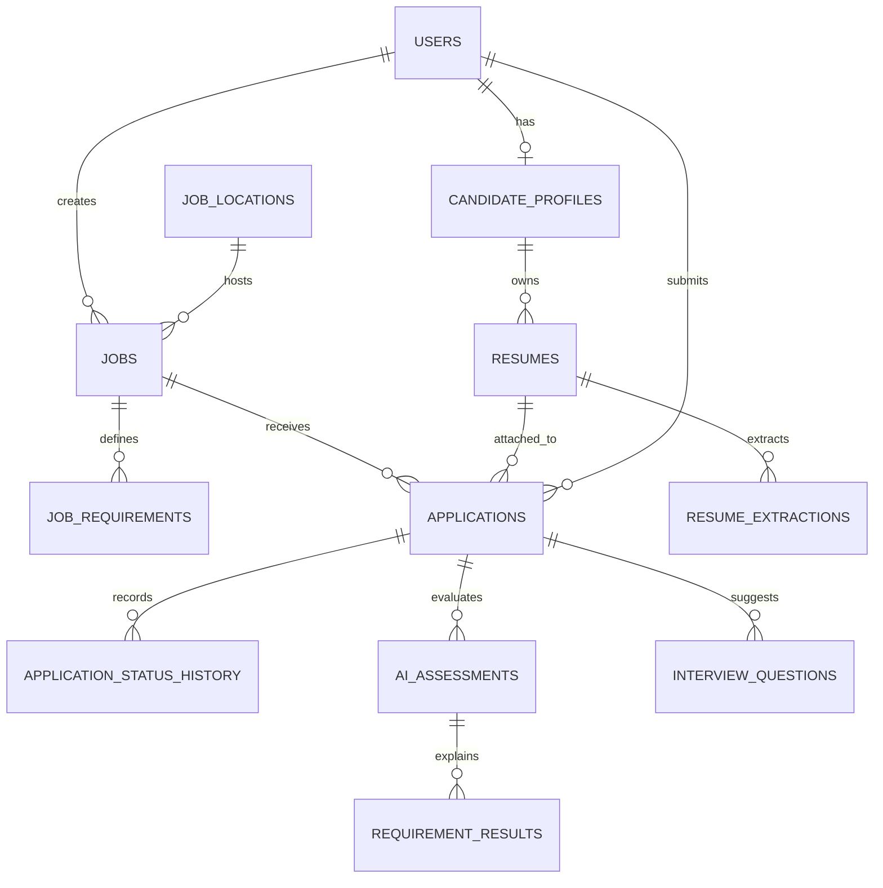

# Thiết kế cơ sở dữ liệu — Lumi Studio

Hệ thống là cổng tuyển dụng **nội bộ cho một công ty** là Lumi Studio tại Đà Nẵng. Vì vậy, giai đoạn đầu không cần bảng `companies` hay `company_members`: mọi tin tuyển dụng thuộc Lumi Studio. Hiện địa điểm lưu ở `recruitment.jobs.location`; `job_locations` là hướng mở rộng khi có nhiều văn phòng.

## Schema đã triển khai

Flyway V1–V8 đã triển khai tài khoản, hồ sơ, tùy chọn nghề nghiệp, tin tuyển dụng, CV có cấu trúc và nền tảng HR/danh mục kỹ năng. V8 bổ sung `recruitment.jobs.headcount`: số nguyên dương, bắt buộc, mặc định 1. Các bảng ứng tuyển, địa điểm riêng, file CV và AI trong thiết kế tổng thể vẫn là phần dự kiến.

| Bảng PostgreSQL | Entity Java |
| --- | --- |
| `auth.users` | `com.lumi.recruitment.entity.auth.User` |
| `candidate.candidate_profiles` | `com.lumi.recruitment.entity.candidate.CandidateProfile` |
| `candidate.resumes` | `com.lumi.recruitment.entity.candidate.Resume` |
| `recruitment.departments` | `com.lumi.recruitment.entity.recruitment.Department` |
| `recruitment.jobs` | `com.lumi.recruitment.entity.recruitment.Job` |
| `catalog.skills` | `com.lumi.recruitment.entity.catalog.Skill` |
| `recruitment.recruiter_profiles` | `com.lumi.recruitment.entity.recruitment.RecruiterProfile` |
| `recruitment.job_skills` | `com.lumi.recruitment.entity.recruitment.JobSkill` |
| `recruitment.job_requirements` | `com.lumi.recruitment.entity.recruitment.JobRequirement` |
| `recruitment.job_history` | `com.lumi.recruitment.entity.recruitment.JobHistory` |
| `public.flyway_schema_history` | Lịch sử migration do Flyway quản lý, không có entity |

```text
entity/
├── auth/
│   ├── User.java
│   ├── UserRole.java
│   └── UserStatus.java
├── candidate/
│   ├── CandidateProfile.java
│   ├── OnboardingStatus.java
│   ├── Resume.java
│   ├── ResumeStatus.java
│   └── ResumeSections.java
├── catalog/
│   └── Skill.java
└── recruitment/
    ├── Department.java
    ├── Job.java
    ├── RecruiterProfile.java
    ├── JobSkill.java
    ├── JobSkillId.java
    ├── JobRequirement.java
    ├── RequirementType.java
    ├── JobHistory.java
    └── JobHistoryAction.java
```

`candidate.candidate_profiles.user_id` vừa là khóa chính vừa tham chiếu `auth.users.id`; JPA giữ quan hệ một–một với `@MapsId`. Schema được khai báo trong `@Table`, độc lập với tên package Java.

V1 chuyển bảng từ `public` bằng `ALTER TABLE ... SET SCHEMA`, giữ nguyên dữ liệu, UUID, mật khẩu đã băm, index và constraint. Trên database mới, V1 tạo cấu trúc tương đương. Kỹ năng hồ sơ ứng viên vẫn là `TEXT`; kỹ năng CV là dữ liệu có cấu trúc của V5. V7 chuyển nguồn đọc kỹ năng tin tuyển dụng sang `catalog.skills` và `recruitment.job_skills`, giữ chuỗi cũ để đối chiếu. Profile HR và danh mục kỹ năng có trigger cập nhật timestamp.

Xem [hướng dẫn khởi tạo, baseline, sao lưu và kiểm tra migration](account-schema-migration.md). Hibernate dùng `validate`; mọi thay đổi cấu trúc tiếp theo phải đi qua migration mới.

## Đơn ứng tuyển đã triển khai (V9)

`recruitment.applications`, `application_resume_snapshots` và `application_status_history` đã có thật. CV gốc ở `candidate.resumes`. Service dùng transaction kết hợp JPA khóa job/profile và JDBC cho snapshot JSONB, không dựa vào Hibernate để tạo bảng. Xem [schema, quan hệ và API đơn](applications-api.md). Các bảng AI/ghi chú trong thiết kế mở rộng bên dưới vẫn chưa triển khai.

## Thiết kế mở rộng dự kiến

Sơ đồ và các bảng bên dưới mô tả hướng mở rộng. Cột đã triển khai của tin tuyển dụng
theo [V3/V7/V8](recruitment-jobs.md); bảng tiêu chí hiện có theo [HR/catalog V7–V8](recruitment-catalog-and-hr.md).



| Bảng | Cột quan trọng | Mục đích |
| --- | --- | --- |
| `auth.users` | `id UUID PK`, `email UNIQUE`, `password_hash`, `full_name`, `role`, `status`, `created_at` | Một tài khoản đăng nhập. `role`: `CANDIDATE`, `RECRUITER`, `COMPANY_ADMIN`. |
| `candidate.candidate_profiles` | `user_id PK/FK`, `headline`, `phone`, `skills TEXT`, `experience_years`, `updated_at` | Hồ sơ mở rộng cho ứng viên. Chỉ tồn tại với `CANDIDATE` trong luồng đăng ký. |
| `job_locations` | `id UUID PK`, `name`, `address`, `city`, `is_active` | Khởi tạo một bản ghi: Lumi Studio, Đà Nẵng. |
| `recruitment.jobs` (đã triển khai) | `id UUID PK`, `department_id FK`, `title`, `headcount`, `description`, `location TEXT`, `work_mode`, `employment_type`, `experience_level`, `salary_min`, `salary_max`, `status`, `created_by FK`, `updated_by FK`, `version`, `published_at`, `application_deadline` | Một vị trí tuyển dụng của Lumi Studio. `status`: `DRAFT`, `PUBLISHED`, `CLOSED`. `headcount` là số người cần tuyển, độc lập với số hồ sơ. `location_id` chỉ là hướng mở rộng. |
| `recruitment.job_requirements` (V7) | `id UUID PK`, `job_id FK`, `type`, `is_required`, `weight`, `description`, `sort_order` | Các tiêu chí ngoài kỹ năng để AI và recruiter đối chiếu CV–JD. |
| `candidate.resumes` | `id UUID PK`, `candidate_id FK`, thông tin liên hệ, các link, kỹ năng và các mục JSONB, template, status, is_default, version, timestamps | CV có dữ liệu riêng đã triển khai ở V5, không chỉ metadata file. |
| `resume_files` (dự kiến) | CV/version FK, file_key, original_filename, file_size, content_type | File PDF upload/xuất được lưu riêng; chưa triển khai. |
| `applications` | `id UUID PK`, `job_id FK`, `candidate_id FK`, `resume_id FK`, `cover_letter`, `status`, `applied_at`, `updated_at` | Đơn ứng tuyển. Ràng buộc `UNIQUE(job_id, candidate_id)` để một người chỉ nộp một lần cho một tin. |
| `application_status_history` | `id UUID PK`, `application_id FK`, `from_status`, `to_status`, `changed_by FK`, `note`, `created_at` | Lịch sử chuyển trạng thái đơn, phục vụ theo dõi và audit. |
| `resume_extractions` | `id UUID PK`, `resume_id FK`, `parser_version`, `content JSONB`, `created_at` | Kết quả trích xuất CV do FastAPI xử lý. |
| `ai_assessments` | `id UUID PK`, `application_id FK`, `model_name`, `prompt_version`, `score`, `summary`, `risk_note`, `created_at` | Kết quả đánh giá hỗ trợ recruiter, không tự quyết định tuyển dụng. |
| `requirement_results` | `id UUID PK`, `assessment_id FK`, `requirement_id FK`, `match_level`, `evidence`, `reason` | Bằng chứng cho từng tiêu chí của một lần đánh giá AI. |
| `interview_questions` | `id UUID PK`, `application_id FK`, `assessment_id FK`, `question`, `reason`, `status` | Câu hỏi phỏng vấn do AI gợi ý để recruiter chọn dùng. |

## Quan hệ và quy tắc chính

- `auth.users.role = CANDIDATE` có tối đa một `candidate.candidate_profiles`; `RECRUITER` và `COMPANY_ADMIN` quản lý tin và đơn của Lumi Studio.
- Khi mở rộng nhiều văn phòng, mỗi tin có thể thuộc một `job_locations`; hiện dùng trường `location` dạng văn bản.
- `applications.status` dùng các giá trị `SUBMITTED`, `REVIEWING`, `INTERVIEW`, `OFFER`, `REJECTED`, `WITHDRAWN`. Mỗi lần đổi trạng thái phải thêm một hàng vào `application_status_history`.
- AI service chỉ ghi `resume_extractions`, `ai_assessments`, `requirement_results`, `interview_questions` qua Spring Boot. Frontend React không gọi FastAPI trực tiếp.
- Cần index cho `jobs(status, published_at DESC)`, `jobs(location_id, status)`, `applications(job_id, status)`, `applications(candidate_id, applied_at DESC)` và `users(email)`.

## Thứ tự triển khai PostgreSQL

1. V1–V8 đã triển khai tài khoản, hồ sơ, tin tuyển dụng (gồm số lượng cần tuyển), tùy chọn nghề nghiệp, `candidate.resumes`, profile HR, danh mục kỹ năng và các bảng con của tin.
2. API/giao diện tạo, sửa, đăng, đóng/mở lại và lịch sử tin đã hoàn thành. Tiếp theo: đơn ứng tuyển thật, snapshot CV khi nộp, `applications`, `application_status_history`, API hồ sơ/ghi chú/chuyển vòng của HR và profile HR; file CV cần luồng upload/xem/tải riêng. Xem [trạng thái chức năng HR](recruiter-features.md).
3. Kết nối Spring Boot với FastAPI và thêm bốn bảng kết quả AI.
4. Khi Lumi Studio mở thêm chi nhánh, thêm bản ghi vào `job_locations`. Chỉ khi sản phẩm thực sự phục vụ nhiều công ty mới tách thêm `companies` và `company_members`.

## Implemented candidate onboarding (V2)

`candidate.candidate_profiles` now includes `location`, `desired_position`,
`onboarding_status` and `onboarding_step`. Fixed questions and API contracts are documented
in [candidate-onboarding.md](candidate-onboarding.md). Profile answers persist through the
candidate service; no dynamic question tables or additional schemas are created by V2.

## Implemented recruitment (V3)

`recruitment.departments` and `recruitment.jobs` now exist with public list/detail APIs.
See [recruitment-jobs.md](recruitment-jobs.md) for actual columns, constraints, filters and visibility.
No real job records are seeded by migration; recruiter publishing, applications and AI remain future work.

## CV có cấu trúc (V5)

`candidate.candidate_profiles` có quan hệ 1–N với `candidate.resumes`. Nội dung CV độc lập
với hồ sơ sau khi tạo. Xem [cấu trúc, API và giới hạn hiện tại](candidate-resumes.md).
