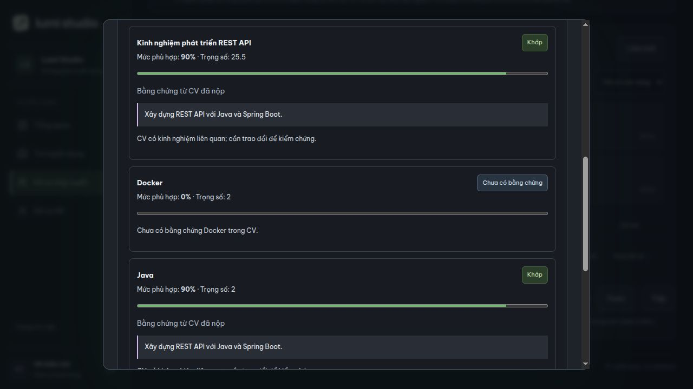
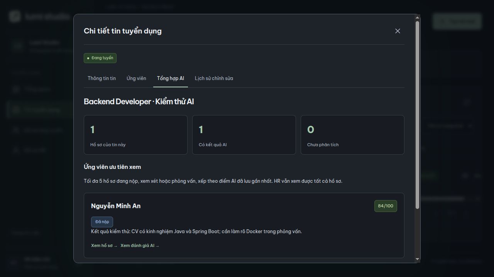
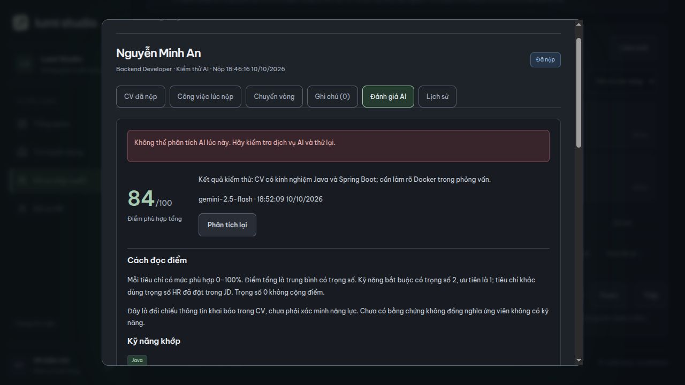
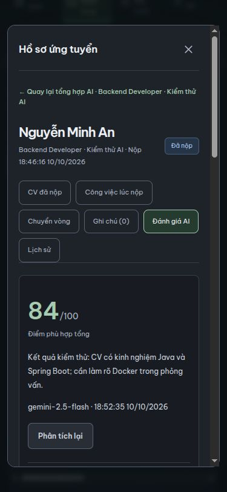

# Đánh giá CV–JD và tổng hợp ứng viên — 10/10/2026

Đã nối giao diện HR → API Java → dịch vụ Python → Gemini, lưu kết quả và cập nhật danh sách/tổng hợp theo job. Môi trường hiện chưa có `GEMINI_API_KEY`, vì vậy chưa nghiệm thu một lần gọi Gemini thật. Kiểm thử dùng CV giả và mô hình giả lập; không gửi CV thật ra ngoài.

## Luồng sử dụng

Tin tuyển dụng → mở job → Ứng viên/Tổng hợp AI → mở hồ sơ → Đánh giá AI → Phân tích ngay. Kết quả đã lưu vẫn đọc được sau khi tải lại. Phân tích lại yêu cầu kết quả mới; lỗi không xóa đánh giá trước đó. AI không chuyển vòng hoặc loại ứng viên.

- `GET /api/recruiter/applications/{id}/assessment`: kết quả gần nhất, `data: null` nếu hồ sơ tồn tại nhưng chưa đánh giá; hồ sơ không tồn tại trả 404. Lỗi dịch vụ không bị đổi thành chưa phân tích.
- `POST` cùng đường dẫn: không có body hoặc `{}` dùng lại kết quả v2 trong 24 giờ; `{"force":true}` gọi mới. Hai yêu cầu đồng thời cho cùng hồ sơ: một yêu cầu xử lý, yêu cầu còn lại 409.
- Chỉ HR/Admin đang hoạt động; POST cần CSRF. Ứng viên không đọc được kết quả nội bộ. Kết quả AI không xuất hiện trong danh sách đơn của ứng viên.
- Python chờ mô hình tối đa 25 giây, Java chờ dịch vụ 30 giây, frontend chờ phân tích 40 giây. Java dùng HTTP/1.1 tương thích Uvicorn.

## Điểm và bằng chứng

Mỗi kỹ năng/tiêu chí trong JD tại lúc nộp có khóa riêng. Kỹ năng bắt buộc có trọng số 2, tùy chọn 1; tiêu chí khác giữ đúng trọng số JD, gồm cả phần thập phân và 0. Tất cả mục đều được đánh giá, không giới hạn 8 kỹ năng.

`Điểm tổng = round_half_up(Σ(điểm phù hợp × trọng số) / Σ trọng số)`

Điểm từng mục là số nguyên 0–100, hiển thị phần trăm; trọng số hiển thị riêng. Ví dụ Java 90%, trọng số 2; Docker 0%, trọng số 2; REST API 90%, trọng số 25,5 → điểm tổng 84/100. Không hiển thị 90/2 như điểm phù hợp.

Cả Python và Java kiểm tra đủ/đúng khóa, không trùng, không đổi trọng số, không vượt 100, trạng thái hợp lệ và có lý do/bằng chứng. Không có bằng chứng phải chấm 0 và ghi rõ giới hạn. Java kiểm tra lại tổng điểm trước khi ghi. Kết quả sai hoặc lỗi lưu không tạo bản đánh giá dở dang.

Đầu vào là CV và JD snapshot bất biến tại lúc nộp, bao gồm kinh nghiệm, dự án, học vấn, chứng chỉ, ngôn ngữ, giải thưởng và hoạt động; không cắt nội dung mỗi mục xuống 300 ký tự. Prompt coi CV/JD là dữ liệu, không làm theo chỉ dẫn bên trong. Không dùng tên để chấm điểm. Link GitHub/project chưa được truy cập để xác minh. Điểm hiện phản ánh độ phù hợp của nội dung CV, không phải năng lực đã kiểm chứng hoặc độ tin cậy độc lập.

## Database và tổng hợp

Schema `recruitment`:

- `applications` → `ai_assessments`: một hồ sơ có nhiều lần phân tích; lưu mô hình, phiên bản prompt, điểm, tóm tắt, kỹ năng, khoảng thiếu, câu hỏi và thời gian.
- `ai_assessments` → `ai_assessment_criteria`: chi tiết điểm, bằng chứng, lý do, trọng số và khóa mục.
- V12 đổi `weight` sang `numeric(5,2)`, thêm `criterion_key` và khóa duy nhất trong một đánh giá. Dữ liệu V11 giữ nguyên; mục cũ được phép thiếu khóa.

Danh sách lấy đánh giá gần nhất theo thời gian và ID, chưa đánh giá hiển thị Chưa phân tích. Tổng hợp tính số hồ sơ có kết quả, không tăng khi cùng hồ sơ được phân tích lại. Nhóm ưu tiên tối đa 5 hồ sơ có kết quả, điểm giảm dần, chỉ vòng Đã nộp/Đang xem xét/Phỏng vấn và đúng job. Hồ sơ kết thúc hoặc chưa đánh giá vẫn có trong danh sách đầy đủ.

## Cấu hình và kiểm thử

Tạo `ai-service/.env` theo `.env.example`, điền khóa Gemini tại máy và khởi động lại dịch vụ Python. Không đưa khóa vào frontend hoặc commit. Có thể chọn mô hình qua `GEMINI_MODEL` (mặc định `gemini-2.5-flash`). Health chỉ xác nhận dịch vụ đang chạy, không chứng minh khóa/mô hình đã sẵn sàng.

Đã qua 67 kiểm thử backend trên PostgreSQL cô lập, 8 kiểm thử Python, 3 file kiểm thử frontend, build và lint frontend. Bao phủ quyền/CSRF, lưu/đọc/cache/phân tích lại, JSON snapshot, trọng số thập phân, thiếu/trùng/sai tiêu chí, lỗi/timeout/rollback, yêu cầu đồng thời, số đếm và giới hạn đúng job. Kiểm thử tích hợp Java dùng dịch vụ mô phỏng; kiểm tra trình duyệt chạy qua FastAPI thật với mô hình giả lập.

V12 đã áp dụng trên database local sau khi sao lưu; đối chiếu dữ liệu tài khoản, CV, tin, đơn, snapshot, ghi chú và lịch sử trước/sau không thay đổi. Bản sao lưu nằm trong `backend/backups/`, không đưa vào commit.

Chưa nghiệm thu chất lượng câu trả lời, quota/chi phí và độ ổn định của Gemini thật do thiếu khóa. Cần kiểm tra trên bộ CV/JD có kết quả kỳ vọng trước khi coi điểm AI là công cụ hỗ trợ tuyển dụng đã sẵn sàng sử dụng rộng rãi.

Kiểm tra trình duyệt: phân tích lần đầu, phân tích lại, lỗi mô hình giữ kết quả cũ, tải lại vẫn có kết quả, mở từ tổng hợp đúng job, số có đánh giá vẫn là 1 sau nhiều lần phân tích. Màn desktop và 375×812 không tràn ngang. Đã dọn database/dịch vụ kiểm thử cô lập; ứng dụng chính giữ nguyên dữ liệu.

Ảnh bên dưới dùng CV giả và mô hình giả lập, không phải kết quả Gemini thật:

