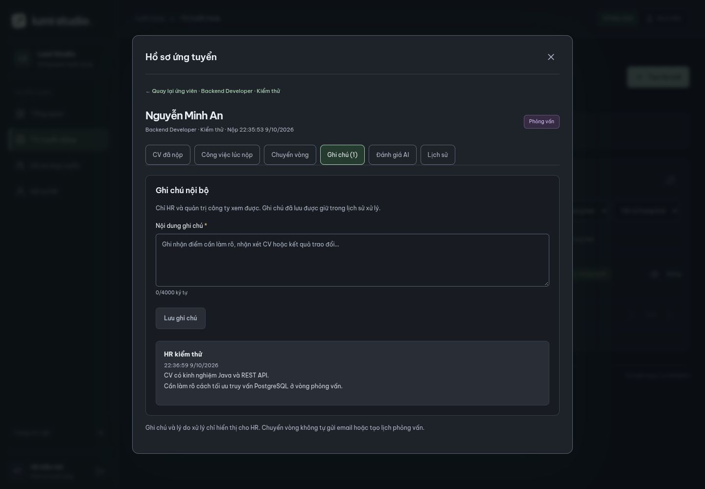
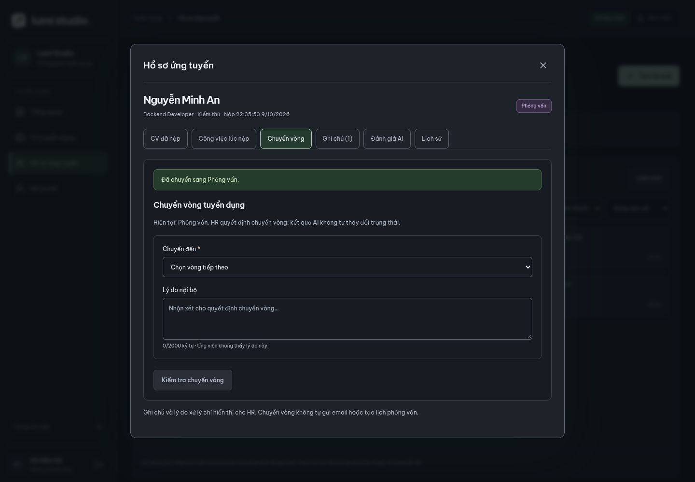
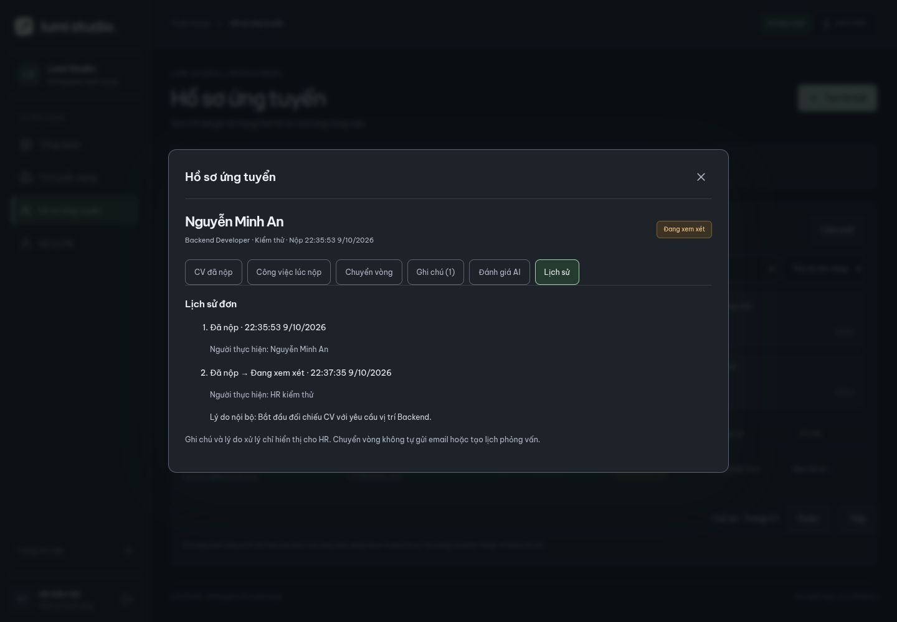
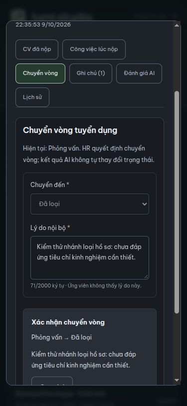

# HR xử lý hồ sơ thật — V10, 09/10/2026

Đã triển khai ghi chú nội bộ, chuyển vòng và lịch sử xử lý cho `RECRUITER`/`COMPANY_ADMIN`, dùng cùng hồ sơ thật trong **Hồ sơ ứng tuyển** và **Tin tuyển dụng → job → Ứng viên**. Không gọi AI, gửi email, tạo lịch hoặc phát hành offer từ thao tác chuyển vòng.

## Database

Migration `V10__application_review_notes.sql`, schema `recruitment`:

- `application_notes`: UUID PK, `application_id → applications.id`, `author_id → auth.users.id`, `author_name`, `body` (không rỗng, tối đa 4.000 ký tự), `request_id`, `created_at`.
- Quan hệ application–notes là 1–n. `UNIQUE(application_id, request_id)` chống tạo hai ghi chú khi gửi lại cùng yêu cầu; cùng mã nhưng đổi nội dung/người viết trả 409. Index theo application/time/id.
- Ghi chú chỉ thêm; trigger chặn sửa/xóa. Tên người viết được giữ tại lúc viết.
- `application_status_history` thêm `actor_name`, giữ tên người thực hiện ở các sự kiện mới. Sự kiện cũ bất biến, khi đọc lấy tên từ tài khoản hiện tại.
- Chuyển vòng chỉ đổi `applications.status`, `version + 1`, `updated_at`, đồng thời thêm lịch sử from/to, actor, reason, timestamp. CV/JD snapshot, danh tính đơn, thư và thời điểm nộp giữ nguyên.
- Ghi chú không thay version/trạng thái đơn; version kiểm soát chuyển vòng. Các thao tác ghi khóa dòng application để tuần tự hóa, cùng transaction với lịch sử. Lỗi lịch sử làm rollback trạng thái.

## API

| Endpoint | Body / kết quả |
| --- | --- |
| GET `/api/recruiter/applications/{id}/review` | `{application, notes, history, allowedTransitions}` trong `ApiResponse.data`; application giữ hợp đồng detail cũ |
| POST `/api/recruiter/applications/{id}/notes` | `{body, requestId: UUID}` → 201 + review mới; gửi lại cùng yêu cầu trả cùng trạng thái đã lưu |
| POST `/api/recruiter/applications/{id}/status` | `{version, status, reason?}` → 200 + review mới; reason tối đa 2.000 ký tự, bắt buộc khi REJECTED |

Các endpoint require ACTIVE HR/Admin; actor lấy từ phiên, POST require CSRF. Không nhận người viết từ client. 401 chưa đăng nhập/inactive, 403 sai role/thiếu CSRF, 404 không có đơn, 400 dữ liệu không hợp lệ, 409 version cũ hoặc chuyển vòng không hợp lệ.

`GET /api/candidate/applications/{id}` giữ DTO riêng: chỉ trạng thái và thời gian trong lịch sử; không chứa notes, actor, reason nội bộ. Endpoint detail chung cũ `/api/recruiter/applications/{id}` vẫn hoạt động; UI HR dùng `/review` để lấy thông tin xử lý.

Hiện phạm vi là một công ty Lumi như API quản lý tin. Chưa có phân vùng nhiều công ty.

## Quy tắc chuyển vòng

| Từ | HR được chuyển đến |
| --- | --- |
| Đã nộp / SUBMITTED | Đang xem xét / REVIEWING hoặc Đã loại / REJECTED |
| Đang xem xét / REVIEWING | Phỏng vấn / INTERVIEW hoặc REJECTED |
| Phỏng vấn / INTERVIEW | Offer / OFFER hoặc REJECTED |
| Offer / OFFER | Đã tuyển / HIRED hoặc REJECTED |
| HIRED / REJECTED / WITHDRAWN | Kết thúc, không chuyển lại |

UI chỉ hiển thị lựa chọn server cho phép. Không nhảy vòng/lùi vòng trong bản đầu. HR không đặt WITHDRAWN; ứng viên rút đơn chưa được triển khai. Tin đóng/hết hạn vẫn xử lý được đơn đã nhận. Khi version cũ, UI báo rõ và yêu cầu **Tải lại hồ sơ**, không ghi đè.

## Cách thử trên ứng dụng

1. HR tạo/đăng một tin; ứng viên hoàn tất CV READY và nộp đơn như [hướng dẫn nộp](applications-api.md).
2. HR chọn **Dữ liệu thật → Hồ sơ ứng tuyển → Xem hồ sơ** (hoặc từ tab Ứng viên của job).
3. **Ghi chú**: nhập nhận xét → Lưu ghi chú. Thấy người viết, thời gian và nội dung xuống dòng. Tải lại rồi mở lại vẫn còn.
4. **Chuyển vòng**: chọn vòng tiếp theo, nhập lý do tùy chọn; nếu loại bắt buộc lý do → Kiểm tra chuyển vòng → Xác nhận chuyển vòng. Hủy xác nhận quay lại form.
5. **Lịch sử**: thấy từ vòng nào đến vòng nào, ai xử lý, thời gian và lý do nội bộ.
6. Đóng hồ sơ: số lượng vòng và danh sách cập nhật, giữ bộ lọc job/tên/vòng. Nếu hồ sơ vừa rời vòng đang lọc thì không còn trong kết quả; đổi bộ lọc để xem. Trang vượt quá trang cuối sau thay đổi sẽ được điều chỉnh.
7. Ứng viên mở Đơn ứng tuyển/tải lại: trạng thái và lịch sử cập nhật, không có nội dung HR riêng tư.

Chế độ **Xem mẫu** vẫn dùng dữ liệu riêng trong phiên. Không dùng mẫu để thay khi API thật lỗi.

## Xác minh

- 62 kiểm thử backend chạy qua, không skipped: 15 migration, 46 API/login, 1 context. Có V9→V10 giữ dữ liệu cũ/rerun, bảo vệ ghi chú/lịch sử bất biến, quyền/CSRF/ACTIVE, ghi chú idempotent, đủ chuỗi đến HIRED và nhánh REJECTED, bắt buộc lý do loại, chặn nhảy/lùi/terminal/version cũ, chuyển đồng thời chỉ một yêu cầu thành công, rollback trạng thái khi insert audit lỗi, candidate không lộ nội bộ, CV/JD không đổi.
- Frontend build/lint và hai suite hiện có qua. Trình duyệt dùng database/tài khoản/CV kiểm thử riêng: ứng viên nộp → HR ghi chú → REVIEWING → INTERVIEW → REJECTED; bộ lọc/số đếm cập nhật, xem từ job cùng ghi chú, thiếu lý do loại bị chặn; ghi chú/trạng thái/lịch sử giữ sau tải lại.
- Desktop 1440×1000 và mobile 375×812: form/dialog không tràn ngang; khôi phục viewport sau kiểm tra.
- Sao lưu database đang dùng trước V10, áp dụng qua Flyway; đối chiếu dữ liệu tài khoản/CV/job/application/snapshot/lịch sử cũ giữ nguyên. Không thêm hồ sơ kiểm thử vào database đang dùng.

Ảnh từ database kiểm thử riêng:

