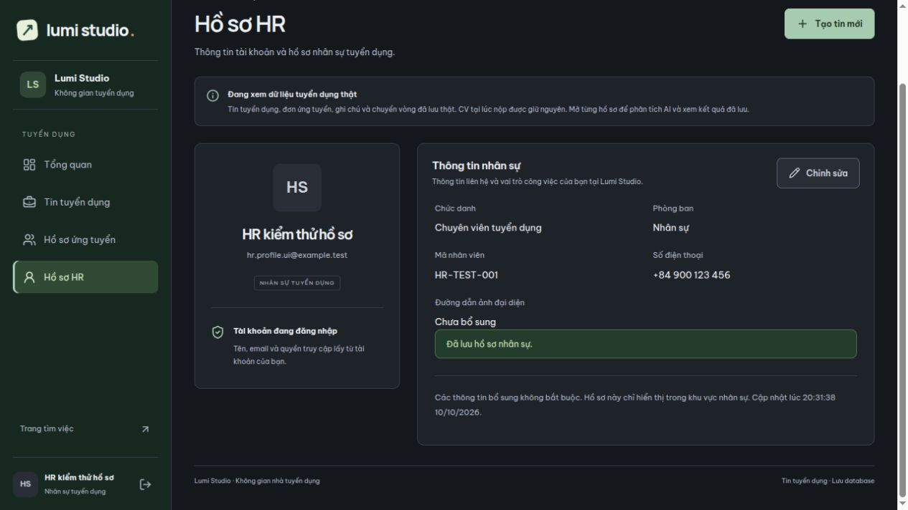
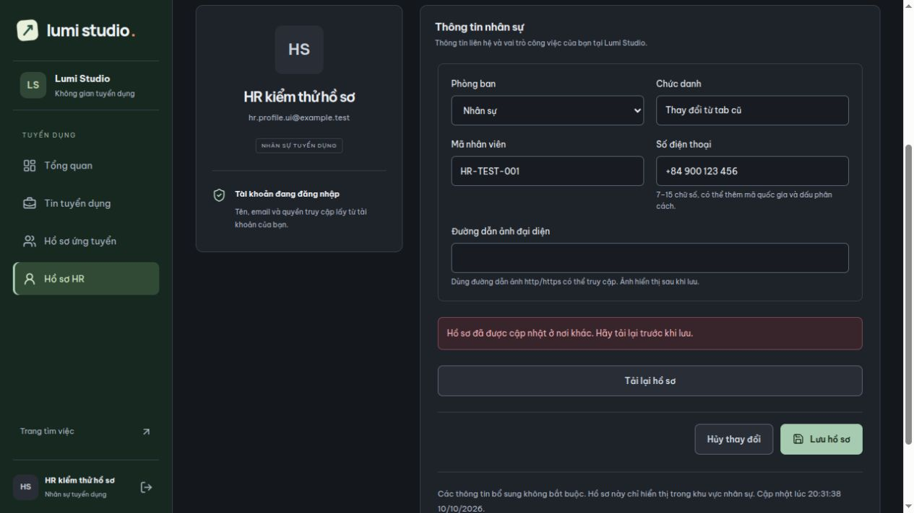
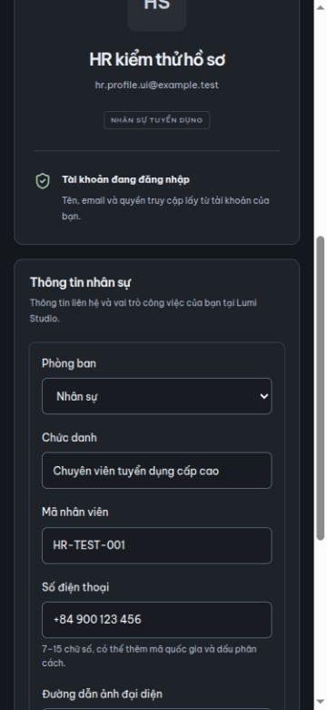

# Hồ sơ HR thật — 10/10/2026

Vào khu vực HR → Hồ sơ HR → Chỉnh sửa → Lưu hồ sơ. Dữ liệu đọc/ghi từ `recruitment.recruiter_profiles`, không dùng thông tin mẫu trong chế độ thật. Chế độ Xem mẫu giữ riêng trong phiên.

Có thể bổ sung hoặc xóa chức danh, mã nhân viên, số điện thoại, phòng ban và URL ảnh đại diện. Tên, email và quyền lấy từ tài khoản, chỉ đọc. Phòng ban chọn từ danh mục đang hoạt động, lưu bằng `department_id` FK; phòng ban cũ ngừng hoạt động vẫn hiển thị và được giữ nguyên khi sửa trường khác.

## API

- `GET /api/recruiter/profile`: hồ sơ của người đang đăng nhập, không nhận ID người khác. Tài khoản mới chưa có record được trả về hồ sơ trống phiên bản 0, GET không tự ghi database.
- `PUT /api/recruiter/profile`: yêu cầu CSRF và `version` hiện tại; cập nhật đầy đủ 5 trường bổ sung. Trường bỏ trống hoặc null sẽ xóa giá trị cũ. Tạo record khi lưu lần đầu.
- HR và Company Admin đang hoạt động chỉ sửa hồ sơ của chính mình. Tên/email/role/userId từ body không thay đổi tài khoản. Không trả password/hash.
- 400: dữ liệu không hợp lệ; 401: chưa đăng nhập/tài khoản ngừng hoạt động; 403: sai role/thiếu CSRF; 409: mã nhân viên trùng hoặc form cũ. Lỗi lưu giữ nội dung đang sửa; có thể tải lại hồ sơ khi bị xung đột.

Ví dụ body:

```json
{
  "version": 0,
  "jobTitle": "Chuyên viên tuyển dụng",
  "employeeCode": "HR-001",
  "phone": "+84 900 123 456",
  "departmentId": null,
  "avatarUrl": null
}
```

Giới hạn: chức danh 255 ký tự; mã nhân viên 50 và duy nhất không phân biệt hoa/thường; điện thoại tối đa 30 ký tự chứa 7–15 chữ số cùng + hoặc dấu phân cách; URL ảnh tối đa 2048 ký tự, http/https, có host, không chứa tài khoản/mật khẩu. Server kiểm tra lại, không chỉ dựa vào form. URL ảnh được hiển thị sau lưu, lỗi ảnh quay về chữ viết tắt; chưa có upload file ảnh.

## Database

Dùng bảng đã có từ V7. Quan hệ: `auth.users` 1–0..1 `recruitment.recruiter_profiles`; nhiều profile có thể thuộc một `recruitment.departments`. V13 chỉ thêm `version bigint NOT NULL DEFAULT 0` cùng kiểm tra không âm. Java entity có `@Version`; API dùng cập nhật có điều kiện `user_id` và `version`, tăng version khi lưu. Hai tab lưu cùng phiên bản: một thành công, tab còn lại 409. Mã trùng hoặc lỗi không tạo record dở dang. `created_at` giữ nguyên, `updated_at` có trigger cập nhật.

V13 đã áp dụng trên database local sau sao lưu tại `backend/backups/`; đối chiếu dữ liệu nghiệp vụ trước/sau giữ nguyên, ngoài cột version mới. Kiểm thử dùng database riêng với tài khoản giả.

## Kiểm thử

74 kiểm thử backend qua, gồm 6 trường hợp API profile mới và một kiểm thử nâng cấp V12→V13. Bao phủ đọc không ghi, tạo/lưu/xóa trường, dữ liệu sai, quyền/CSRF/tài khoản ngừng hoạt động, không sửa identity/người khác, phòng ban ngừng hoạt động, mã trùng không phân biệt hoa/thường, rollback, form cũ và hai lần lưu đầu đồng thời.

4 file kiểm thử frontend qua; bổ sung kiểm tra payload chỉ gửi trường được sửa, version/CSRF, giá trị trống thành null, lỗi không biến thành thành công và validation. Frontend build/lint qua.

Kiểm tra trình duyệt qua backend thật với tài khoản giả trong database cô lập: hồ sơ mới trống, sửa/lưu, hủy không lưu, điện thoại sai, tải lại vẫn giữ dữ liệu, hai tab sửa cùng phiên bản báo xung đột và giữ draft, tải lại lấy bản mới, URL ảnh lỗi có chữ viết tắt dự phòng. Form ở viewport 375×812 không tràn ngang. Đã khôi phục viewport và dọn môi trường thử; tab chính đang mở Hồ sơ HR.

Ảnh dùng tài khoản kiểm thử riêng:




