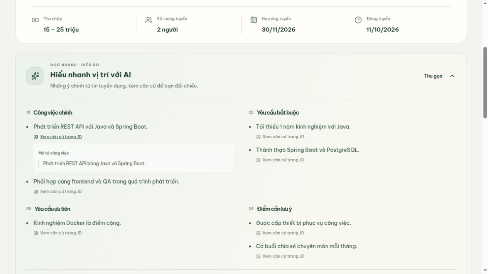
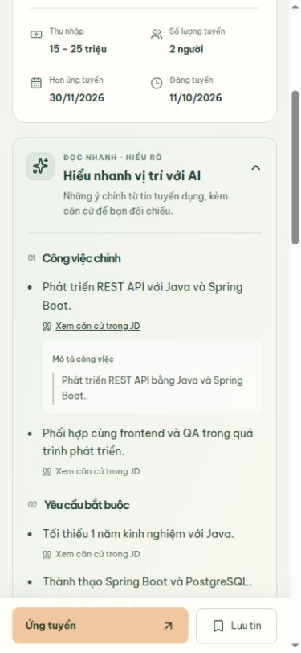

# AI tóm tắt tin tuyển dụng

Trang `/jobs/:id` có khối **Hiểu nhanh vị trí với AI**, ngay sau thông tin lương/hạn tuyển và trước JD. Mặc định thu gọn; chỉ khi người xem mở khối mới đọc cache hoặc yêu cầu tạo tóm tắt. Không gọi AI khi chỉ tải trang.

## Nội dung và căn cứ

- Bốn nhóm: công việc chính, yêu cầu bắt buộc, yêu cầu ưu tiên, điểm cần lưu ý; mỗi nhóm tối đa bốn ý.
- Mỗi ý có **Xem căn cứ trong JD**, mở trích dẫn nguyên văn cùng tên nguồn. React hiển thị văn bản, không thực thi HTML/markdown từ model.
- Nhóm thiếu ý tóm tắt được ghi rõ là chưa có ý, không khẳng định JD không có yêu cầu đó.
- Desktop hai cột, điện thoại một cột; hỗ trợ bàn phím, trạng thái tải/lỗi, giảm chuyển động, nút đọc JD đầy đủ không thêm mục lịch sử trình duyệt.
- `data=sample` chỉ có thông báo mẫu; không chạy AI và không giả kết quả AI thật. Ảnh kiểm thử dưới đây dùng API giả tách biệt, không chèn dữ liệu mẫu vào database ứng dụng.

## API và dữ liệu

- `GET /api/jobs/{id}/ai-summary`: trả cache còn khớp JD, hoặc `data: null`; không gọi model.
- `POST /api/jobs/{id}/ai-summary`: tạo hoặc trả lại cache. Không nhận JD từ client; backend tự đọc dữ liệu. Khách có thể dùng, vẫn yêu cầu CSRF như các POST khác.
- Java gọi `POST /api/job-summary` của dịch vụ Python. Nguồn chỉ gồm thông tin vị trí, mô tả, yêu cầu, quyền lợi, kỹ năng và tiêu chí cấu trúc; không gửi CV hoặc hồ sơ ứng tuyển.
- Migration V15 tạo `recruitment.job_ai_summaries`, khóa chính/FK `job_id → recruitment.jobs(id)`. Lưu `source_hash`, `prompt_version`, `model_name`, `items` JSONB và `generated_at`.
- Một bản cache hiện hành cho mỗi job, không phải bảng lịch sử hoặc bảng chấm điểm ứng viên. SHA-256 bao gồm nội dung JD, phiên bản job, kỹ năng, cờ bắt buộc/ưu tiên, tiêu chí và tên phòng ban. JD thay đổi thì cache cũ không được trả; lần mở tiếp theo tạo lại.
- Chỉ tin đang công khai, còn hạn và phòng ban hoạt động được đọc/tạo tóm tắt. Tin đóng/ẩn/hết hạn trả 404 kể cả khi có cache.
- Khóa PostgreSQL ngăn hai yêu cầu cùng tạo một job; tối đa hai lượt gọi provider đồng thời trên một backend. Không có tùy chọn buộc tạo lại cache từ client.
- Kiểm tra lại nguồn sau khi AI hoàn tất; nếu JD vừa thay đổi, trả 409 và không lưu kết quả cũ. Giao diện yêu cầu tải lại tin. Đây cũng là cách xử lý khi một lượt tạo khác đang chạy.
- Hai tầng Python/Java kiểm tra ID job/hash/prompt, giới hạn số ý, nhóm hợp lệ, nguồn hợp lệ và trích dẫn đúng đoạn liên tiếp. Kiểm tra trích dẫn không thay thế việc người dùng đối chiếu ý nghĩa; model vẫn có thể diễn giải sai. Không dùng tóm tắt để chấm điểm hoặc quyết định tuyển dụng.
- Timeout provider 25 giây, backend 30 giây, frontend 45 giây; lỗi không lưu cache, không tạo tóm tắt giả và không ghi nội dung model vào log.

## Cấu hình và chạy

Ba server hiện có vẫn là frontend 5173, backend 8080, Python AI 8000. Backend tự áp dụng V15 khi khởi động.

Đặt `GEMINI_API_KEY` trong `ai-service/.env` (tham khảo `.env.example`) rồi khởi động lại dịch vụ AI. Có thể cấu hình `GEMINI_MODEL` theo model tài khoản đang dùng; mặc định giữ cấu hình Gemini hiện có của dự án. Không đưa khóa vào frontend hoặc commit `.env`.

Để thử: HR đăng một tin thật → mở chi tiết ở danh sách việc làm → **Xem tóm tắt** → mở căn cứ → tải lại và mở lại để dùng cache. Sửa JD bằng tài khoản HR rồi mở lại để kiểm tra làm mới.

Môi trường kiểm tra hiện chưa cấu hình khóa Gemini. Luồng thành công được kiểm tra với provider/API mô phỏng; endpoint Python thật đã xác nhận trả 503 an toàn khi thiếu khóa. Chưa xác nhận chất lượng diễn giải với model thật.

## Kiểm tra đã thực hiện

- 81 kiểm thử backend đạt trên các database PostgreSQL tự tạo và xóa riêng, gồm cache dùng chung, CSRF, nguồn server, invalidation, tin ẩn/hết hạn, trích dẫn giả, provider lỗi/timeout, gọi đồng thời và chỉnh JD giữa lúc tạo.
- 14 kiểm thử Python đạt, gồm sáu kiểm thử mới cho tóm tắt: nguồn trích dẫn, cờ ưu tiên, giới hạn đầu vào/đầu ra, prompt, provider và timeout.
- Frontend build và 13 kiểm thử hiện có đạt. Lint còn cảnh báo cũ ở `TopCandidatesWidget.tsx`; không có lỗi mới.
- Trình duyệt với API thử riêng: mở lần đầu có loading; bốn nhóm và trích dẫn hiển thị; thu gọn/mở lại không gọi thêm; reload đọc cache; lỗi có thử lại; 409 có tải lại tin; link JD giữ focus và không đổi URL; desktop 1280px và mobile 390px không tràn ngang.

