# Giao diện HR — cập nhật 09/10/2026

Trang `/recruiter` dành cho `RECRUITER` và `COMPANY_ADMIN`, dùng phiên đăng nhập thật.
Giao diện nền xám than, panel/bảng/form/modal xám đậm phân tầng, chữ sáng.
Sidebar xanh đậm; xanh nhạt dành cho nút chính, điều hướng/luồng đang chọn và trạng thái tích cực.
CSS giới hạn trong khu vực HR, bao gồm các modal; giao diện ứng viên không đổi.

Danh sách chức năng và mức hoàn thành hiện tại: [Chức năng HR](recruiter-features.md).

## Bảng màu HR

- Nền `#14171c`, panel `#1e2229`, khối nổi `#282d36`, ô nhập `#181c22`.
- Sidebar `#172820`, điểm nhấn xanh `#a7cbb0`; nút phụ và nhãn kỹ năng dùng xám.
- Vòng tuyển dụng: Đã nộp xanh dương, Đang xem xét vàng, Phỏng vấn tím, Offer cyan, Đã tuyển xanh lá, Đã loại đỏ dịu, Đã rút xám. Bộ lọc có chấm màu tương ứng, luôn kèm tên trạng thái; số lượng dùng chữ sáng trung tính.
- CV mẫu xem trên giấy trắng/chữ đậm; CV thật giữ bố cục template. Khung xung quanh CV dùng xám đậm; màu chữ CV không bị hộp thoại ghi đè.
- Khung AI dùng xám, biểu tượng AI tím; màu khớp/cần làm rõ trong đánh giá vẫn có ý nghĩa riêng.
- Kiểm tra desktop 1440×1000 và mobile 375×812: danh sách, dialog CV không tràn ngang. Chữ CV mẫu đạt ít nhất 5,48:1 trong các phần đã đo; chữ/bộ lọc ở danh sách thật đạt ít nhất 6,84:1 trong các phần đã đo. Build/lint frontend qua. Bảng màu không thay đổi quy trình tuyển dụng; chức năng ATS thật được ghi ở mục V10 bên dưới.

Ảnh màu mới ở chế độ mẫu:

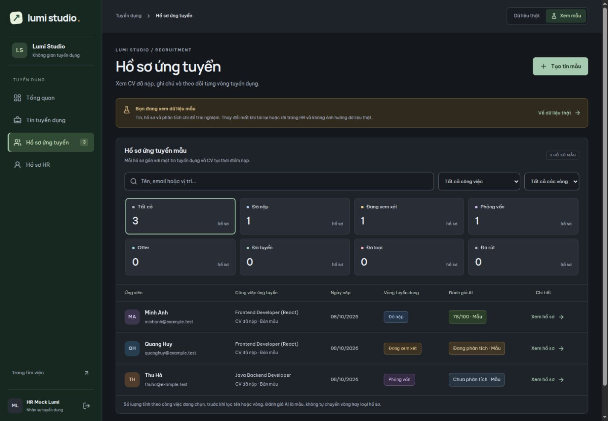
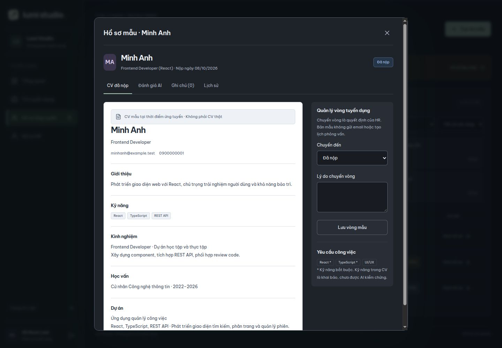
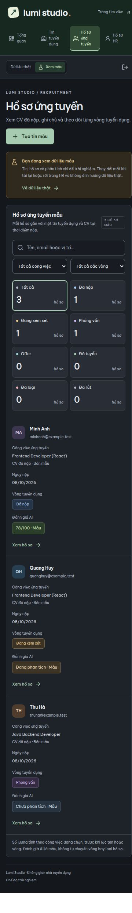

## Bốn màn hình chính

- **Tổng quan:** số tin công khai/đang tuyển mẫu, hồ sơ, hồ sơ chờ xem xét; danh sách tin và hồ sơ cần xử lý. Phân tích AI là một thẻ minh họa riêng.
- **Tin tuyển dụng:** tìm tên/kỹ năng không dấu, lọc phòng ban/trạng thái, phân trang; số hồ sơ từng tin, hạn nộp, ngày cập nhật. Chi tiết có Thông tin tin, Ứng viên, Tổng hợp AI và Lịch sử chỉnh sửa. Nút số hồ sơ mở ngay tab Ứng viên của job. Quản lý tin thật gồm sửa, đăng, đóng, mở lại và lịch sử; hồ sơ và thao tác ATS đã nối API thật; đánh giá AI đã nối dịch vụ và database, cần cấu hình khóa Gemini.
- **Hồ sơ ứng tuyển:** lọc công việc, tên/email/vị trí và vòng tuyển dụng; các ô Tất cả/Đã nộp/Đang xem xét/Phỏng vấn/Offer/Đã tuyển/Đã loại/Đã rút tính số hồ sơ theo công việc đang chọn, trước khi lọc tên/vòng. Bỏ số thứ tự 01–05 để tránh nhầm với số lượng. Có cột Đánh giá AI và nút Xem hồ sơ; màn hẹp hiển thị từng hồ sơ dạng thẻ. Chi tiết thật gồm CV/JD tại lúc nộp, Chuyển vòng, Ghi chú, AI và Lịch sử. Chỉ nhánh loại bắt buộc lý do; các vòng kết thúc không cho HR chuyển tiếp. Không gửi email hoặc tạo lịch khi thử thao tác.
- **Hồ sơ HR:** tên/email/role từ tài khoản đang đăng nhập; thông tin bổ sung đã xem/lưu thật gồm chức danh, phòng ban, mã nhân viên, điện thoại, URL ảnh. Có chỉnh sửa/lưu/hủy, kiểm tra điện thoại/URL, mã trùng và phiên bản. Ảnh hiển thị từ URL; chưa upload file.

## Form và bản xem trước tin

Form có ba bước: **Thông tin vị trí → Yêu cầu & nội dung → Xem trước**.

Trước form tạo mới có [màn hình chọn 3 cách](recruiter-job-create-ui.md): nhập thủ công,
nhập JD có sẵn và AI hỗ trợ viết JD. Hai luồng AI hiện chỉ có giao diện nhập liệu,
không phân tích/gửi file hoặc tạo nội dung. Sửa tin mẫu vào thẳng form.

- Tên vị trí, phòng ban, cấp độ, cách làm việc, hình thức hợp đồng và địa điểm.
- Số lượng cần tuyển bắt buộc, mặc định 1; chỉ nhận số nguyên dương trong giới hạn INTEGER. Không dùng số hồ sơ ứng tuyển làm số lượng tuyển.
- Lương thỏa thuận/khoảng lương/từ/đến; nhập đầy đủ VND/tháng. Kiểm tra số không âm, khoảng lương không đảo ngược; bỏ mức lương không còn dùng khi lưu.
- Hạn nộp tùy chọn, tính đến cuối ngày theo giờ Việt Nam. Có thể lưu nháp đã hết hạn; phải cập nhật hạn trước khi đăng/mở lại hoặc lưu sửa tin đang tuyển.
- Kỹ năng bắt buộc/ưu tiên, chống trùng tên không phân biệt hoa thường.
- Tiêu chí có loại (kinh nghiệm, học vấn, ngoại ngữ, khác), mô tả, bắt buộc/ưu tiên và trọng số 0–100.
- Mô tả công việc, yêu cầu ứng viên, quyền lợi; giữ xuống dòng khi xem trước.

Bản xem trước hiển thị thông tin vị trí, số lượng cần tuyển, lương/địa điểm/hợp đồng/hạn nộp, nhóm kỹ năng rồi nội dung và tiêu chí. **Trọng số chỉ xuất hiện khi HR xem chi tiết nội bộ**, không xuất hiện trong bước xem trước công khai. Khi sửa, giữ dữ liệu và trạng thái tin; ghi lịch sử mẫu. Đóng form đã thay đổi cần xác nhận bỏ nội dung, có thể quay lại tiếp tục soạn. Đăng/đóng/mở lại từ danh sách hoặc chi tiết có bước xác nhận.

## Phân biệt chức năng thật và mẫu

| Chức năng | Trạng thái |
| --- | --- |
| Đăng nhập/đăng xuất, giới hạn role | Thật |
| Xem tin công khai, tìm tên/kỹ năng, lọc phòng ban, phân trang | Thật, API `/api/jobs` và `/api/departments` |
| Thống kê tin đã công khai | Thật; không tính bản nháp, tin đóng/ẩn/hết hạn |
| Tạo bản nháp, xem tin/lịch sử và tạo phòng ban | Thật; [API tạo bản nháp](recruiter-job-api.md), giữ dữ liệu sau tải lại |
| Sửa nháp/tin đã đóng, đăng/đóng/mở lại tin | Thật; có xác nhận, kiểm tra hạn nộp và phiên bản, lịch sử lưu cùng transaction |
| Xem CV/JD đã nộp, danh sách/đếm hồ sơ và lịch sử ban đầu | Thật; V9 + API; ghi chú/chuyển vòng/lịch sử đã nối V10; rút đơn chưa làm |
| Chuyển vòng, ghi chú và lịch sử người xử lý/lý do | Thật; [V10](hr-application-review.md), đủ chuỗi đến Đã tuyển và nhánh loại có lý do |
| Hồ sơ HR bổ sung | Đã đọc/ghi hồ sơ của chính mình qua API, dùng `recruitment.recruiter_profiles`, phòng ban FK và version V13 |
| Tổng hợp ứng viên theo job, đánh giá CV–JD trong hồ sơ | Đã nối API/database V11–V12; cần khóa Gemini để phân tích thật; chế độ Xem mẫu vẫn riêng biệt |
| % phù hợp từng kỹ năng, xác minh kỹ năng, Skill Passport, phỏng vấn/video | Chưa triển khai; điểm trọng số mẫu không phải % phù hợp hoặc điểm năng lực |

Mặc định đọc dữ liệu thật. Số hồ sơ từng tin và bộ đếm các vòng lấy từ API, hiển thị 0 khi chưa có đơn. API lỗi có thông báo/thử lại; không tự thay bằng dữ liệu giả. Kết quả truy vấn cũ không ghi đè truy vấn mới. Danh sách HR gồm bản nháp/đang tuyển/đã đóng và ngày cập nhật.

**Xem mẫu** có dữ liệu riêng trong trang HR. Thay đổi được giữ khi chuyển mục/chế độ trong trang; đặt lại khi tải lại hoặc rời trang. Không ghi database, không xuất bản ra trang ứng viên, không gửi thông báo. CV minh họa là nội dung cố định; chế độ thật dùng snapshot CV/JD được lưu tại lúc nộp. Không có quyết định tuyển dụng tự động từ AI.

## Đánh giá AI trong hồ sơ

- Bấm đánh giá AI ở danh sách mở thẳng tab Đánh giá AI của đúng ứng viên. Nút Xem hồ sơ/tên ứng viên mở CV. Thẻ Xem phân tích mẫu ở Tổng quan cũng mở hồ sơ Minh Anh với tab AI, dùng cùng một kết quả.
- Minh Anh có kết quả cố định 78/100 mẫu: React 40/40, TypeScript 30/30, UI/UX 0/20 do chưa có bằng chứng và kinh nghiệm 8/10 cần làm rõ. Hiển thị nguồn CV, giải thích điểm, cách tính và câu hỏi kiểm chứng. Trọng số là minh họa, không dùng cấu hình chấm điểm thật của tin. Kỹ năng khai báo không được gắn nhãn đã xác minh.
- Quang Huy minh họa trạng thái đang phân tích; không có tác vụ AI chạy và không tự cập nhật. Thu Hà chưa phân tích, không hiển thị điểm 0. Giao diện cũng xử lý trạng thái lỗi và thiếu kết quả.
- Chế độ thật đã gọi API Java → Python → Gemini, lưu kết quả và tải lại từ database; cần khóa Gemini để gọi mô hình. Điểm kỹ năng là 0–100%, trọng số hiển thị riêng. Lỗi tải khác với chưa có kết quả; lỗi phân tích lại vẫn giữ kết quả cũ. Kết quả không tự chuyển vòng hoặc loại hồ sơ. Xem [hợp đồng đánh giá và kiểm thử](hr-ai-assessment.md).

## Quản lý ứng viên theo job

- Trong chi tiết tin, tab Ứng viên dùng chung danh sách/bộ lọc vòng với trang Hồ sơ ứng tuyển, nhưng khóa công việc theo job đang mở. Xóa bộ lọc không bỏ giới hạn job; số hồ sơ cũng tính trong job.
- Tab Tổng hợp AI thống kê tổng số hồ sơ, số có đánh giá và số chưa có kết quả. Nhóm ưu tiên hiển thị tối đa 5 hồ sơ có kết quả gần nhất đã lưu (hoặc kết quả minh họa trong Xem mẫu), xếp điểm giảm dần, chỉ ở vòng đã nộp/xem xét/phỏng vấn. Offer, đã tuyển, đã loại, đã rút vẫn có trong danh sách tất cả nhưng không được xếp ưu tiên. Thiếu kết quả không tính là 0 điểm.
- Nút Xem hồ sơ hoặc Xem đánh giá AI mở cùng nội dung chi tiết ứng viên ngay trong dialog job, không chồng dialog mới. Quay lại/Đóng/Escape từ hồ sơ trở về tab job; Đóng/Escape lần nữa đóng tin.
- Xem tất cả/Mở danh sách hồ sơ sang mục Hồ sơ ứng tuyển, chọn sẵn đúng job. Danh sách tổng thể vẫn cho phép đổi hoặc bỏ bộ lọc job.
- Ghi chú và chuyển vòng trong hai nơi cập nhật cùng bản ghi thật ở database; số đếm cập nhật sau thao tác. Job không có hồ sơ hoặc chưa có đánh giá có trạng thái trống; không lấy dữ liệu job khác. Tab Ứng viên và Tổng hợp AI đã nối API thật; số đánh giá đếm theo hồ sơ, nhóm ưu tiên lấy điểm và tóm tắt gần nhất từ database. Xem tin mẫu chuyển sang danh sách tin mẫu để chọn riêng, không gắn hồ sơ mẫu vào tin thật.

Database HR/jobs đã có [V7–V8](recruitment-catalog-and-hr.md), bao gồm số lượng cần tuyển. [Tạo bản nháp thật](recruiter-job-api.md) đã hoàn thành. Đã hoàn thành [sửa và đăng/đóng/mở lại tin thật](recruiter-job-lifecycle.md). Đã nối [nộp đơn và xem CV snapshot thật V9](applications-api.md). Ghi chú/chuyển vòng HR đã chạy thật bằng V10; đánh giá AI đã triển khai bằng V11–V12; tiếp theo rút đơn ứng viên và nghiệm thu mô hình thật; API profile HR đã kết nối bằng V13.

## Xác minh

- Liên kết job–hồ sơ: build/lint/test qua, bổ sung kiểm thử giới hạn đúng job, sắp xếp điểm và giữ các hồ sơ chưa đánh giá/đã kết thúc trong danh sách đầy đủ. Trình duyệt kiểm tra Frontend chỉ có 2 hồ sơ, Product Designer không có hồ sơ, mở CV/AI và quay lại tab tin, Escape, chuyển sang danh sách tổng thể đã lọc đúng job, ghi chú mẫu dùng chung. Kiểm tra 1440×1000 và 375×812 không tràn ngang; khôi phục viewport sau kiểm tra.

- Cập nhật đánh giá AI: build/lint/test qua. Trình duyệt kiểm tra mở đúng ứng viên từ cột AI, ba trạng thái mẫu, nút Xem hồ sơ mở CV, đường Tổng quan mở cùng tab AI và lọc Đã loại theo công việc. Màn 1440×1000 và 375×812: trang/dialog không tràn ngang; khôi phục viewport sau kiểm tra.

- V8: build/lint/test qua; trình duyệt chặn số lượng rỗng/0/âm/lẻ, nhập 7 hiện đúng ở bản xem trước và danh sách, mở lại form vẫn là 7. Migration và API đã qua 33 kiểm thử backend.

- Build TypeScript/Vite, lint và test frontend đều qua. Test kiểm tra lương VND, hạn theo giờ Việt Nam, chặn đăng nháp hết hạn, giữ định danh/trạng thái/lịch sử khi sửa và dữ liệu liên kết mẫu.
- Trình duyệt: 0 tin thật; tạo nháp, giữ lương/kỹ năng/tiêu chí khi sửa; kỹ năng trùng; lương đảo ngược; chọn ngày; chặn đăng hết hạn; xem trước ẩn trọng số; đăng/đóng mẫu; cảnh báo bỏ thay đổi.
- Nút số hồ sơ lọc đúng công việc; xem CV đúng ứng viên; chuyển vòng thiếu lý do bị chặn; thêm ghi chú; lịch sử có người thực hiện/thời gian; form HR kiểm tra điện thoại và lưu thông tin mẫu.
- Viewport 375×812: trang và dialog không tràn ngang; form/CV một cột, bảng/tiến trình cuộn trong vùng riêng; đóng modal bằng Escape. Khôi phục viewport mặc định sau kiểm tra.

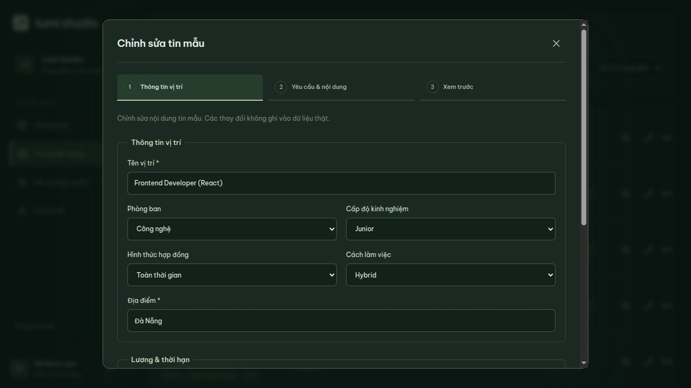
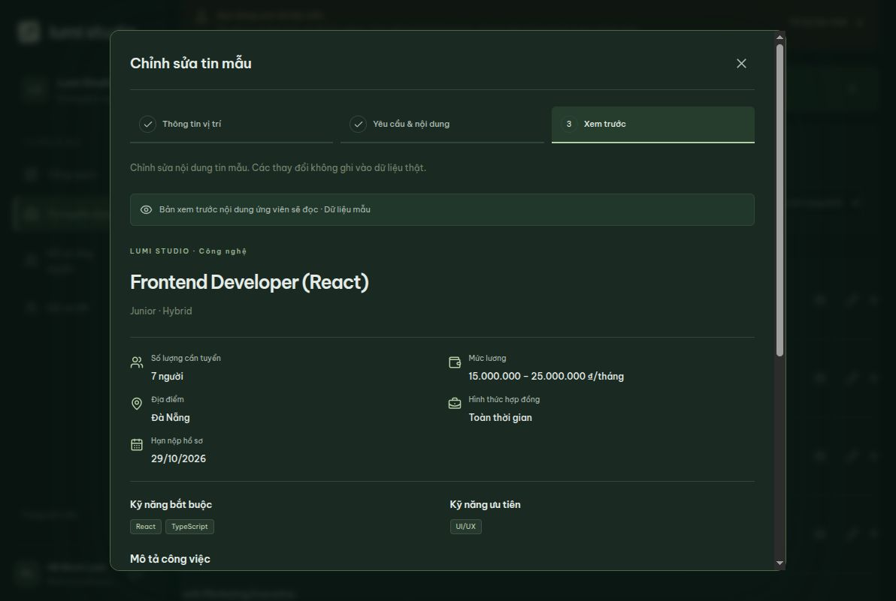
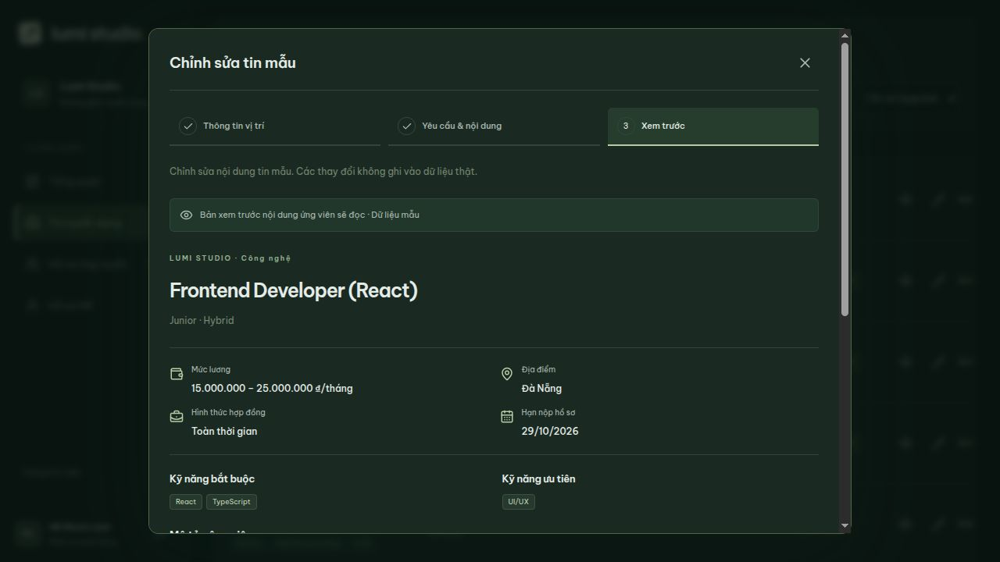
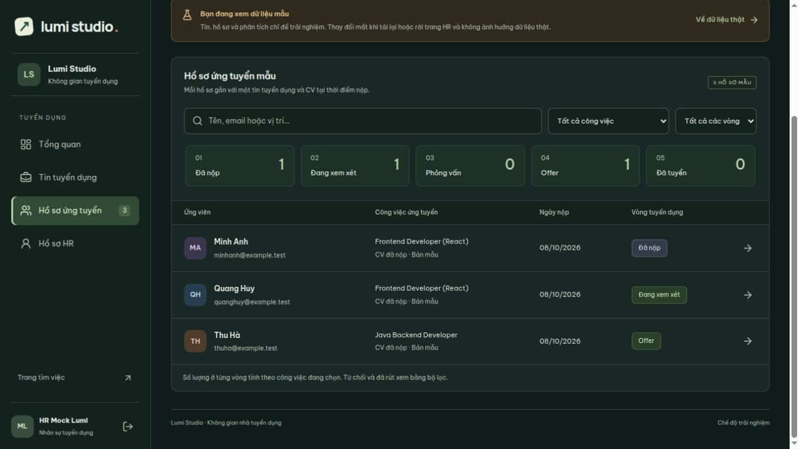
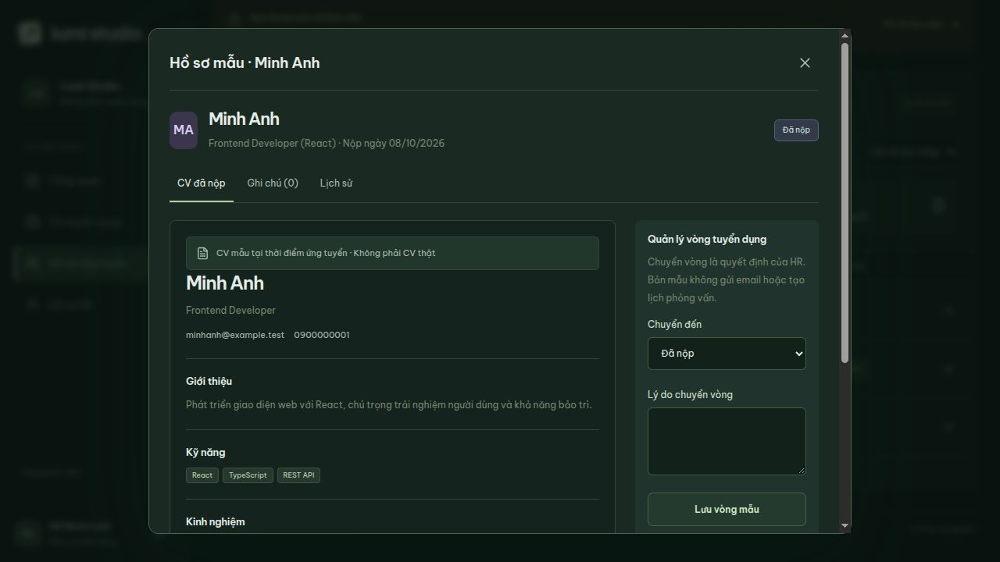
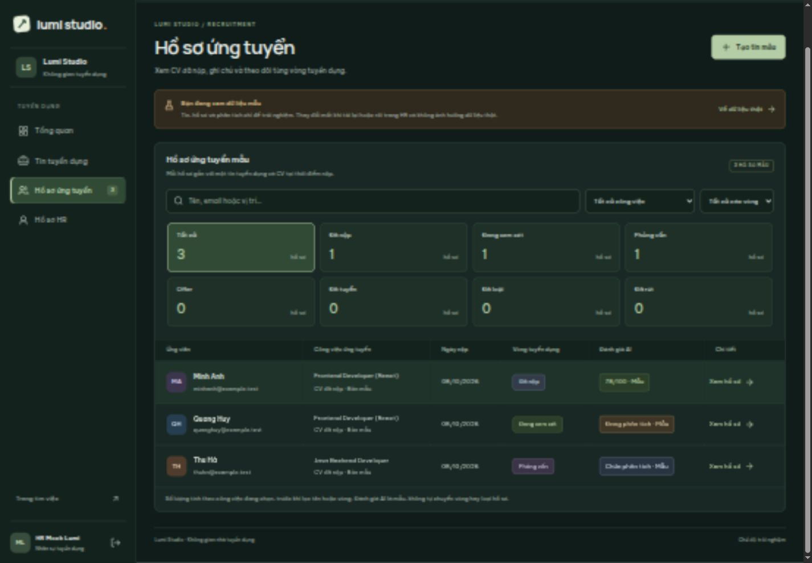
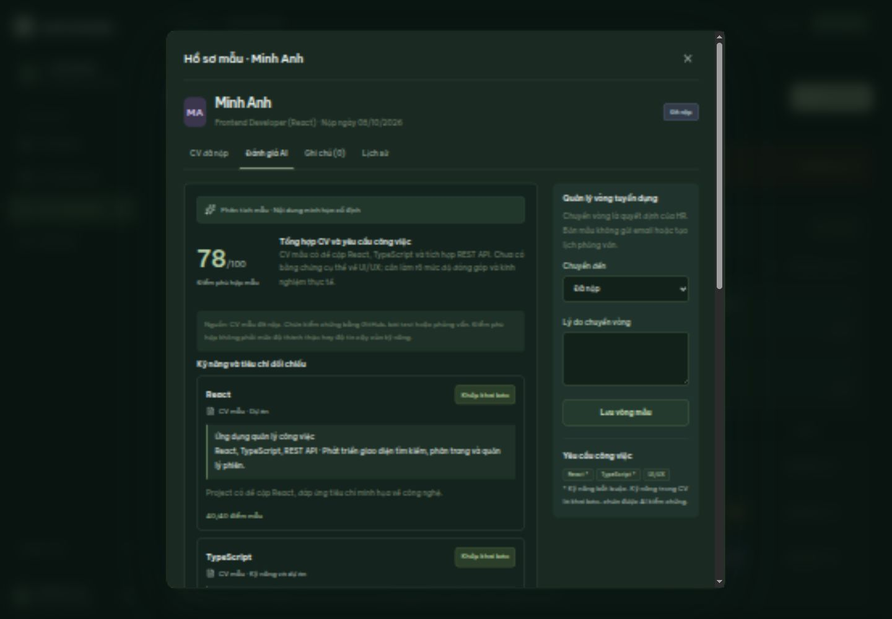
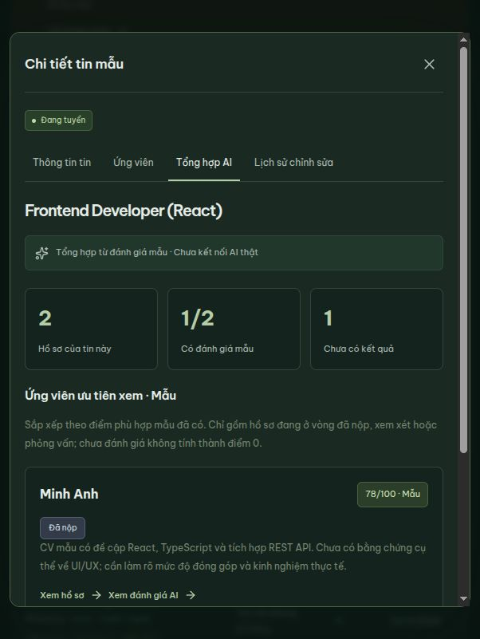
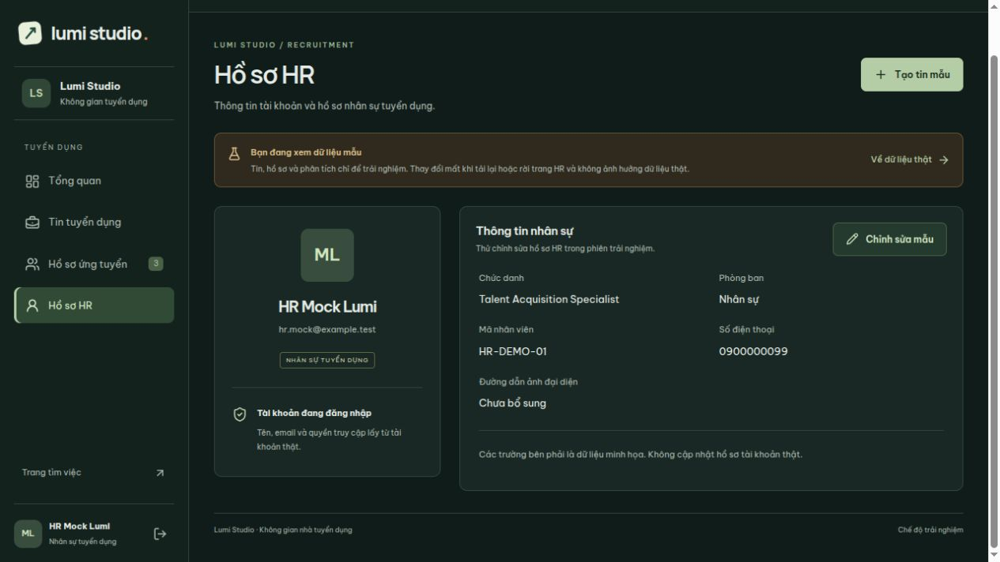
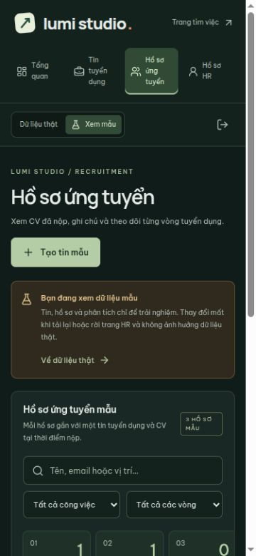

Bản xem trước trong form thật dùng để kiểm tra nội dung trước khi lưu. Đăng tin từ danh sách hoặc chi tiết có xác nhận; tin đang tuyển cần đóng trước khi sửa. Form dùng phòng ban UUID từ database; tạo phòng ban trực tiếp khi cần. 38 kiểm thử backend và kiểm tra trình duyệt cho luồng thật được ghi ở [API tạo bản nháp](recruiter-job-api.md).

## ATS thật V10

[Hướng dẫn và API xử lý hồ sơ](hr-application-review.md): chi tiết thật có tab Chuyển vòng, Ghi chú và Lịch sử. Chỉ chọn vòng hợp lệ do server trả; loại cần lý do; xác nhận trước khi ghi, 409 yêu cầu tải lại. Ghi chú/lịch sử giữ sau tải lại, ứng viên không thấy nội bộ. Cả danh sách tổng thể và ứng viên trong job tự cập nhật số lượng/bộ lọc sau thao tác.

## Hồ sơ HR thật — 10/10/2026

Đã nối xem/lưu thông tin nhân sự của chính tài khoản đang đăng nhập; tên/email/quyền chỉ đọc, phòng ban chọn từ danh mục. Có trạng thái tải/lỗi/thử lại, hủy, lưu, phiên bản chống ghi đè và hiển thị ảnh từ URL. Chế độ mẫu giữ riêng trong phiên. Xem [chi tiết API và kiểm thử](hr-profile.md).
