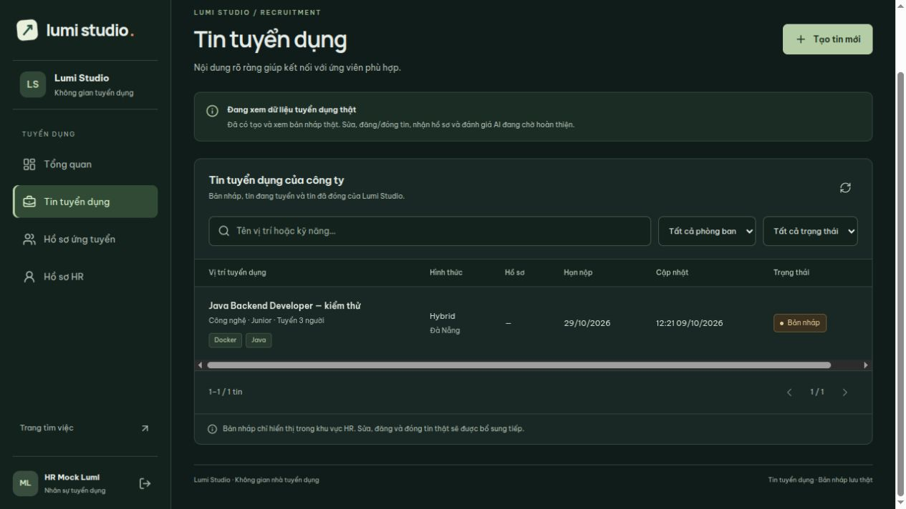
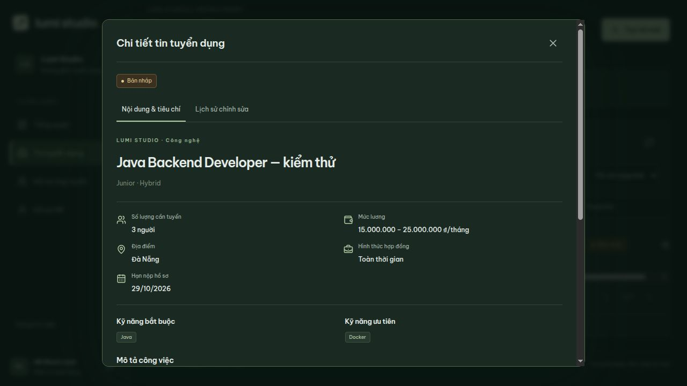

# Tạo bản nháp tuyển dụng thật — 09/10/2026

Đã nối form HR với API và database hiện có V8. Không có migration mới và không
tạo sẵn phòng ban/tin mẫu trong database đang dùng.

## API và quyền

Các endpoint `/api/recruiter/**` yêu cầu phiên của `RECRUITER` hoặc `COMPANY_ADMIN`.
Service kiểm tra lại role/trạng thái tài khoản trong database; POST có CSRF.
Lumi Studio là một công ty: nhân sự tuyển dụng được xem toàn bộ tin của công ty.

| Endpoint | Hành vi |
| --- | --- |
| `POST /api/recruiter/departments` | Nhận `name`, tạo phòng ban hoạt động, trả 201. Tên rỗng/quá 150 ký tự trả 400; trùng tên không phân biệt hoa thường trả 409. |
| `POST /api/recruiter/jobs` | Tạo và trả bản nháp, HTTP 201. |
| `GET /api/recruiter/jobs` | Đọc cả DRAFT/PUBLISHED/CLOSED, tìm tên/kỹ năng, lọc `departmentId` và `status`, phân trang `page`/`size` (1–100). Sắp xếp cập nhật mới nhất, UUID làm thứ tự phụ. |
| `GET /api/recruiter/jobs/{id}` | Nội dung, kỹ năng bắt buộc/ưu tiên, tiêu chí và tối đa 50 lịch sử mới nhất; thiếu tin trả 404. |

GET nội bộ tách khỏi `/api/jobs`: bản nháp luôn bị ẩn khỏi API công khai. API sửa và đổi trạng thái được bổ sung trong [luồng quản lý tin](recruiter-job-lifecycle.md).
Chưa có API xóa tin hoặc ứng tuyển/AI thật.

## Dữ liệu tạo tin

Nhận `departmentId` UUID của phòng ban đang hoạt động; `title`, `headcount`,
`description`, `requirements`, `benefits`, `location`, `employmentType`, `workMode`,
`experienceLevel`, `salaryMin`, `salaryMax`, `applicationDeadline`, `skills`, `criteria`.

- Headcount bắt buộc, nguyên dương, tối đa 2147483647.
- Employment: FULL_TIME/PART_TIME/INTERNSHIP/CONTRACT; mode: ONSITE/HYBRID/REMOTE;
  level: INTERN/JUNIOR/MIDDLE/SENIOR. Các mã ngoài danh sách bị từ chối.
- Lương VND/tháng; hai đầu có thể NULL. Không âm, tối đa 13 chữ số nguyên và 2 chữ
  số thập phân; không đảo ngược. Currency luôn là VND.
- Hạn nhận ngày lịch `YYYY-MM-DD`, lưu hết ngày Việt Nam với độ chính xác microsecond.
  Bản nháp có thể dùng ngày quá khứ; luồng xuất bản tương lai phải kiểm tra lại.
- Tối đa 100 kỹ năng, tên tối đa 100 ký tự, mỗi mục có `name` và `required`.
  Tái sử dụng danh mục bằng chuẩn hóa PostgreSQL của V7; chống trùng và không dùng
  kỹ năng đã ngừng hoạt động. Insert danh mục dùng ON CONFLICT để tránh tạo trùng.
- Tối đa 100 tiêu chí; mỗi mục có `type`, `description`, `required`, `weight` (0–100,
  tối đa 2 số thập phân). Thứ tự lấy từ vị trí trong mảng, ID do server tạo.
- Tên/địa điểm tối đa 255, mô tả/yêu cầu/quyền lợi và mô tả tiêu chí tối đa 20.000
  ký tự. Mô tả công việc, yêu cầu ứng viên không được rỗng; quyền lợi có thể rỗng.

Server gán DRAFT, publishedAt NULL, featured false, người tạo/người cập nhật từ phiên.
Client không được điều khiển lifecycle hoặc danh tính tác giả.

Một transaction lưu `recruitment.jobs`, `catalog.skills` khi cần,
`recruitment.job_skills`, `recruitment.job_requirements`, `recruitment.job_history`
với hành động CREATED. Bất kỳ lỗi nào cũng rollback toàn bộ lần tạo tin. Tạo phòng
ban là thao tác riêng có chủ đích và không bị rollback khi tin chưa lưu.

## Giao diện và xác minh

Chế độ Dữ liệu thật có Tạo tin mới → 3 bước → Lưu bản nháp; có tạo phòng ban khi
danh mục chưa có. Đăng tin thật được thực hiện từ danh sách hoặc chi tiết sau khi lưu; có bước xác nhận. Khi lưu đang chạy, form khóa thao tác và
chặn đóng; lưu lỗi giữ nội dung. Lưu thành công tải lại danh sách từ API; tải lại
trang vẫn thấy tin. Nội dung chi tiết và lịch sử được đọc lại từ server.

38 bài kiểm thử backend đạt trên database PostgreSQL riêng: quyền/CSRF, validation,
lương/ngày/mã, đọc qua phiên mới, tách public/private, danh mục dùng chung và rollback
tin/danh mục/liên kết/tiêu chí/lịch sử khi có kỹ năng không hoạt động. Frontend
build/lint/test qua, có kiểm tra payload UUID/mã/VND/ngày và trường do server quản lý.

Trình duyệt đã thử database riêng rỗng: tạo phòng ban, lưu lỗi giữ nội dung, lưu
thành công tin có 3 người/2 kỹ năng/1 tiêu chí/1 lịch sử, tải lại và xem lịch sử thật.
Database thử nghiệm và máy chủ phụ được dọn sau kiểm tra; không thêm tin thử vào
database đang dùng. Ảnh dưới đây là kết quả từ database kiểm thử riêng.

