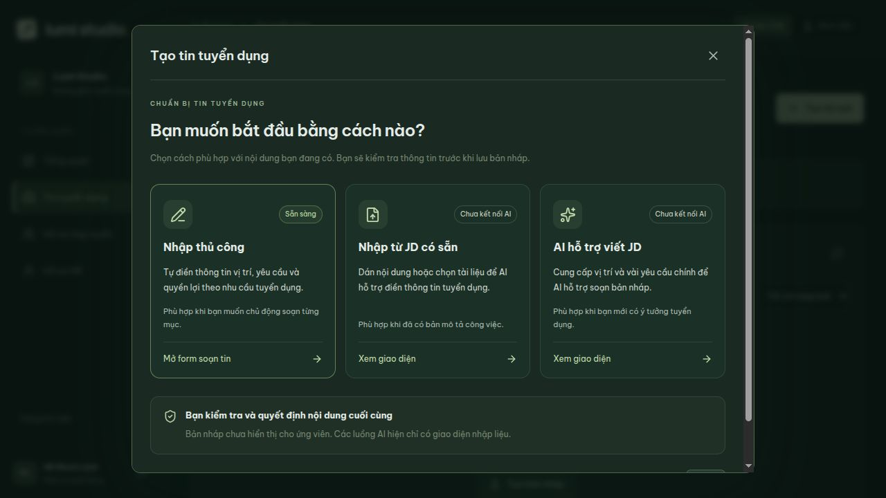
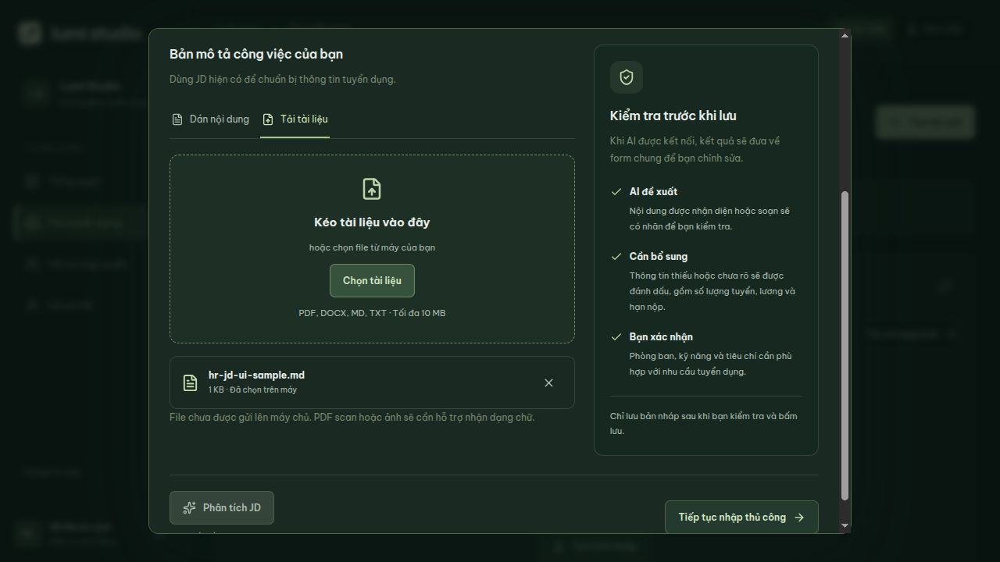
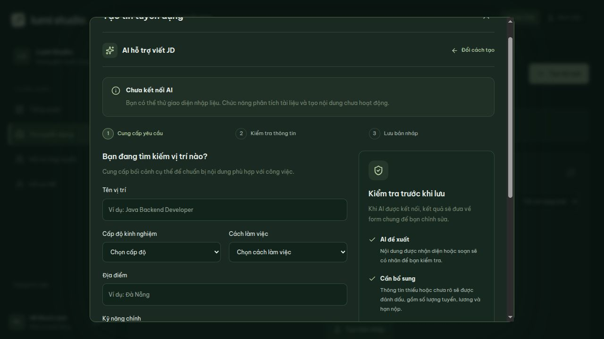
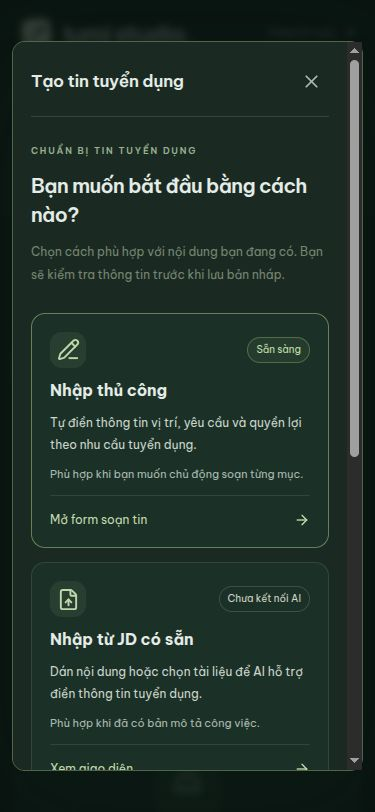

# Ba cách tạo tin — giao diện 09/10/2026

Bấm **Tạo tin mới** trong Dữ liệu thật hoặc **Tạo tin mẫu** trong Xem mẫu sẽ mở
màn hình chọn ba cách. Sửa tin mẫu vẫn mở thẳng form chỉnh sửa.

| Cách | Giao diện | Trạng thái |
| --- | --- | --- |
| Nhập thủ công | Form 3 bước, chỉnh sửa và xem trước | Đã nối API lưu bản nháp thật; chế độ mẫu vẫn chỉ lưu trong phiên |
| Nhập từ JD có sẵn | Dán nội dung hoặc chọn/kéo thả một file PDF/DOCX/MD/TXT, hiển thị tên/dung lượng và bỏ file | Giao diện; AI chưa kết nối, không gửi file lên server |
| AI hỗ trợ viết JD | Vị trí, cấp độ, cách làm việc, địa điểm, kỹ năng, yêu cầu chính và giọng văn | Giao diện; AI chưa kết nối |

Hai màn hình AI có thông báo rõ, nút Phân tích JD/Tạo nội dung bị khóa, không tạo
kết quả giả. Có thể tiếp tục nhập thủ công. Lần chuyển từ brief sang form đầu tiên
đưa tên vị trí/cấp độ/địa điểm/cách làm việc do HR nhập sang form; không giả lập việc
AI trích xuất kỹ năng hoặc tạo mô tả. Form thủ công đã chỉnh sẽ không bị ghi đè.

Nội dung JD, brief, file đã chọn và dữ liệu form được giữ khi Đổi cách tạo trong
cùng modal. Đóng modal có nội dung chưa lưu cần xác nhận, gồm cả Escape. Sau khi
đóng/bỏ thay đổi hoặc tải trang, dữ liệu nhập chưa lưu không được giữ. Tạo phòng ban
là thao tác riêng đã lưu thật, theo hợp đồng API hiện có.

Giới hạn UI: JD dán tối đa 50.000 ký tự; file tối đa 10 MB, chặn file rỗng/sai đuôi;
brief yêu cầu tối đa 5.000 ký tự. Các giới hạn server/upload và nhận dạng nội dung
file phải được kiểm tra lại khi kết nối AI. PDF scan/ảnh hiện chưa có OCR.

Hướng dẫn kiểm tra kết quả AI trong UI giải thích nhãn “AI đề xuất”, “Cần bổ sung”
và việc HR xác nhận trước lưu. Đây là hướng dẫn cho luồng tương lai; chưa có kết quả
AI hoặc nhãn AI gắn lên các trường form thật.

## Xác minh

- Build/lint/test frontend qua. Màn hình chọn cách được tải khi mở modal.
- Trình duyệt: đủ ba lựa chọn, nút AI khóa, chuyển qua lại giữ JD/form/brief;
  form đã chỉnh không bị brief ghi đè; Escape hiện xác nhận và Tiếp tục soạn giữ dữ liệu.
- Chọn file Markdown trên máy: tên/dung lượng hiển thị, thông báo chưa gửi file.
- Luồng thủ công qua các bước xem trước và lưu nháp mẫu thành công; không thêm tin
  thử vào database thật trong đợt UI này. API tạo bản nháp đã kiểm thử ở đợt trước.
- Viewport 375×812: trang và dialog không tràn ngang, ba lựa chọn/khối nhập liệu về
  một cột và cuộn trong dialog; viewport đã trả về mặc định.

