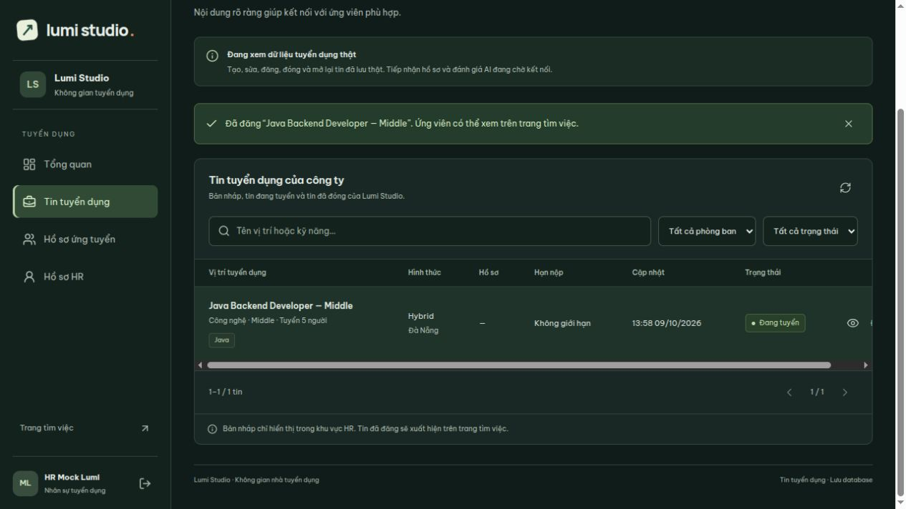
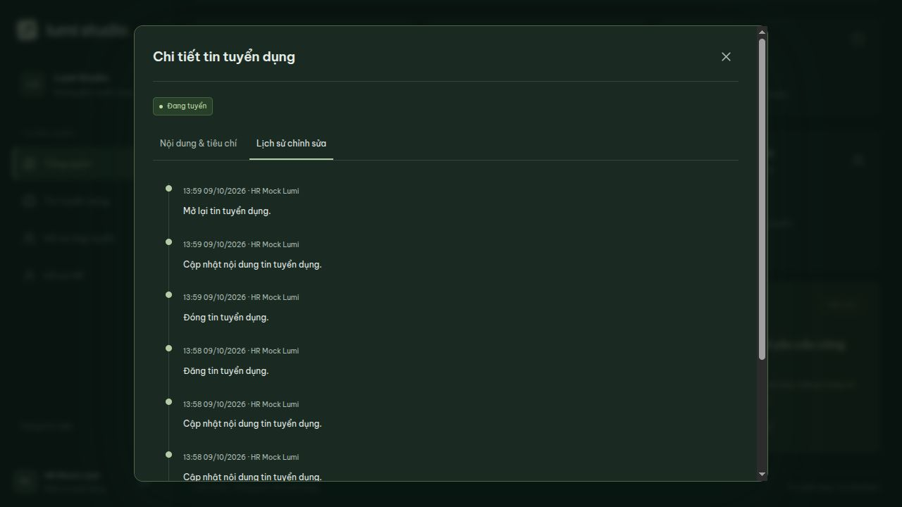

# Sửa, đăng, đóng và mở lại tin — 09/10/2026

Luồng HR đã nối API/database, dùng schema `recruitment` và danh mục kỹ năng `catalog` hiện có V8. Không cần migration mới.

| Thao tác | Điều kiện | Kết quả |
| --- | --- | --- |
| Sửa | DRAFT hoặc CLOSED | Lưu nội dung; giữ ID, người tạo, ngày tạo, trạng thái và ngày đăng lần đầu |
| Đăng | DRAFT | PUBLISHED, gán ngày đăng lần đầu, xuất hiện trên API/trang tìm việc |
| Đóng | PUBLISHED | CLOSED, ẩn khỏi API/trang tìm việc; giữ nội dung và lịch sử |
| Mở lại | CLOSED | PUBLISHED, giữ ngày đăng lần đầu (gán ngày hiện tại nếu tin cũ chưa từng đăng); công khai nếu nội dung/hạn hợp lệ |

Tin đang tuyển cần đóng trước khi sửa. Tin hết hạn tự bị ẩn khỏi API công khai theo bộ lọc hiện có; trạng thái lưu vẫn là PUBLISHED cho đến khi HR đóng. Đóng/mở lại không gửi email, không tạo quyết định tuyển dụng.

## API

Yêu cầu phiên RECRUITER hoặc COMPANY_ADMIN đang hoạt động và CSRF cho mọi thao tác ghi.

- `PUT /api/recruiter/jobs/{id}` nhận `{ "version": 0, "content": { ... } }`. `content` có cùng hợp đồng dữ liệu với POST tạo tin.
- `POST /api/recruiter/jobs/{id}/publish` nhận `{ "version": 0 }`.
- `POST /api/recruiter/jobs/{id}/close` nhận `{ "version": 1 }`.
- `POST /api/recruiter/jobs/{id}/reopen` nhận `{ "version": 2 }`.

Version bắt buộc là số nguyên không âm, lấy từ lần đọc tin. Mỗi lần ghi tăng version. Phiên bản cũ, chuyển trạng thái sai hoặc thao tác đồng thời thua cuộc trả 409 và không tạo lịch sử thừa. Thiếu tin trả 404. Payload/nội dung/hạn không hợp lệ trả 400. Client không điều khiển người thực hiện hoặc trạng thái qua PUT.

Lưu sửa dùng lại validation của tạo tin, thay các liên kết kỹ năng và tiêu chí trong cùng transaction. Trước đăng/mở lại kiểm tra lại toàn bộ nội dung đang lưu, phòng ban/kỹ năng còn hoạt động và hạn nhận hồ sơ. Ngày tính hết ngày Việt Nam; nháp có thể lưu hạn quá khứ. Với tin đã từng đăng, hạn mới còn phải sau ngày đăng lần đầu theo constraint database hiện có.

Mỗi thao tác ghi lịch sử CREATED/UPDATED/PUBLISHED/CLOSED/REOPENED cùng transaction với tin. UPDATED lưu snapshot trước/sau của nội dung, kỹ năng và tiêu chí; các thao tác trạng thái lưu trạng thái trước/sau. Người thực hiện lấy từ phiên. Bảng lịch sử chỉ thêm, không sửa/xóa; entity cũng được đánh dấu bất biến để ORM không tự ghi lại JSON lịch sử.

## Giao diện

**HR → Dữ liệu thật → Tin tuyển dụng**:

1. Chọn biểu tượng bút ở tin nháp/đã đóng, chỉnh form rồi **Lưu thay đổi**. Form đọc lại tin mới nhất khi mở.
2. Chọn **Đăng** và xác nhận để công khai tin đã lưu.
3. Tin đang tuyển có **Đóng**; tin đã đóng có **Sửa** và **Mở lại**.
4. Chi tiết có nội dung, kỹ năng, tiêu chí và **Lịch sử chỉnh sửa**, mới nhất trước.

Có cảnh báo bỏ dữ liệu chưa lưu. Khi đang ghi, chặn đóng modal, xác nhận lại và thao tác form. Lưu lỗi giữ nội dung; 409 hướng dẫn đóng form/mở lại phiên bản mới. Sau thao tác thành công đọc lại danh sách/thống kê từ API. Chế độ Xem mẫu vẫn chỉ thay đổi trong phiên.

## Xác minh

- 47 kiểm thử backend đạt trên PostgreSQL riêng, bao gồm quyền/CSRF, trạng thái đúng/sai, sửa nháp và tin đóng, validation/hạn hết ngày Việt Nam, public/private, đọc lại bằng phiên khác, rollback nội dung/version/kỹ năng/tiêu chí/catalog/lịch sử, hai lần sửa hoặc đăng đồng thời.
- Frontend build/lint/test đạt.
- Trình duyệt với database riêng: tạo nháp, sửa tên/cấp độ/số lượng, lưu nháp hết hạn và chặn đăng; sửa hạn, đăng và thấy trên trang tìm việc; đóng và trang tìm việc không còn tin; sửa số lượng tin đã đóng, mở lại, tải lại trang và đọc đủ lịch sử cùng số lượng mới.
- Backend chính đã khởi động lại với API mới. Tin/phòng ban thử chỉ được tạo trong database riêng, không thêm vào database chính.

Ảnh là kết quả thật từ database kiểm thử riêng:

