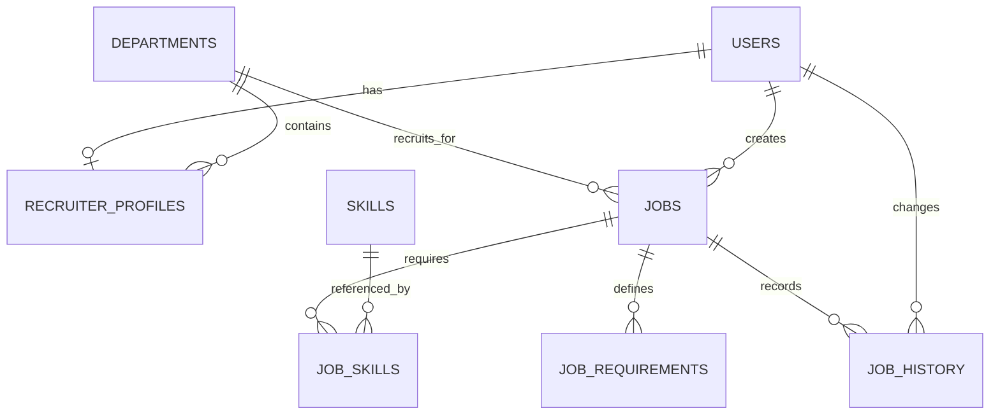

# Database HR và việc làm (V7–V8)

V7 mở rộng phần tuyển dụng cho một công ty Lumi Studio. Tài khoản đăng nhập vẫn dùng
`auth.users`; không tạo tài khoản HR riêng hay bảng công ty. Migration không tạo tin
tuyển dụng, phòng ban hoặc kỹ năng mẫu.

## Các bảng đã triển khai

| Schema/bảng | Dữ liệu và quan hệ |
| --- | --- |
| `catalog.skills` | UUID, tên hiển thị, tên chuẩn hóa duy nhất, trạng thái hoạt động, timestamps. Danh mục kỹ năng dùng chung. |
| `recruitment.recruiter_profiles` | `user_id` vừa PK vừa FK đến tài khoản; mã nhân viên, điện thoại, chức danh, phòng ban, ảnh đại diện, timestamps. |
| `recruitment.jobs` | Giữ cấu trúc V3; V7 bổ sung `updated_by` FK đến tài khoản và `version` để kiểm soát sửa đồng thời; V8 thêm `headcount` số lượng cần tuyển. |
| `recruitment.job_skills` | PK ghép `(job_id, skill_id)`, liên kết N–N giữa tin và kỹ năng; `is_required` phân biệt bắt buộc/ưu tiên. |
| `recruitment.job_requirements` | Tiêu chí ngoài kỹ năng: `EXPERIENCE`, `EDUCATION`, `LANGUAGE`, `OTHER`; mô tả, bắt buộc/ưu tiên, trọng số 0–100, thứ tự hiển thị. |
| `recruitment.job_history` | Người thao tác, hành động, trạng thái trước/sau, ghi chú, thay đổi JSONB, thời điểm. Chỉ thêm; UPDATE/DELETE thông thường bị chặn. |

## Quy tắc dữ liệu

- Profile chỉ gắn với `RECRUITER` hoặc `COMPANY_ADMIN`; một tài khoản có tối đa một
  profile. Tài khoản HR/Admin hiện có được tạo profile tối thiểu; các trường chưa biết
  để NULL. Tài khoản mới cần luồng quản lý nhân sự tạo profile khi cần.
- Mã nhân viên không trùng khi khác chữ hoa/thường. Không được đổi tài khoản có
  profile sang role ứng viên trước khi gỡ profile. Khóa tài khoản không xóa profile.
- Kỹ năng chuẩn hóa chữ hoa/thường và khoảng trắng liên tiếp: ` Spring  Boot ` và
  `spring boot` cùng một kỹ năng. Không bỏ dấu hoặc gộp các tên đồng nghĩa.
- Một tin không được liên kết cùng kỹ năng hai lần. Ngừng dùng kỹ năng bằng
  `is_active=false`; kỹ năng đã được tham chiếu không thể xóa và vẫn xuất hiện trên tin.
- Xóa tin chưa có lịch sử sẽ xóa các liên kết kỹ năng/tiêu chí. Tin đã có lịch sử không
  được xóa vật lý; dùng trạng thái CLOSED. Không xóa dây chuyền tài khoản/phòng ban.
- `Job.version` dùng JPA `@Version`; sửa trên phiên bản cũ bị từ chối. Khi triển khai
  API sửa tin, phải nhận phiên bản khách hàng đã đọc và kiểm tra cả thay đổi các bảng con.
- Lịch sử hỗ trợ `CREATED`, `UPDATED`, `PUBLISHED`, `CLOSED`, `REOPENED`; database
  kiểm tra cặp trạng thái hợp lệ. Lịch sử không tự phát sinh khi sửa tin bằng SQL.
  Dịch vụ ghi tin tương lai phải thêm lịch sử trong cùng transaction với thay đổi tin,
  liên kết kỹ năng và tiêu chí, đồng thời kiểm tra quyền người thao tác.

## Chuyển dữ liệu và API

V7 tách `jobs.skills` cũ theo dấu phẩy, bỏ phần rỗng, chuẩn hóa và loại trùng vào
`catalog.skills` + `job_skills`. Các liên kết cũ đặt `is_required=false` vì dữ liệu cũ
không cho biết kỹ năng bắt buộc. Chuỗi gốc được giữ nguyên để đối chiếu.

`jobs.skills` là cột tương thích cũ, không còn là nguồn cho API đọc. Mọi luồng ghi mới
phải dùng `job_skills`; không có đồng bộ tự động với chuỗi cũ. API `/api/jobs` và
`/api/jobs/{id}` vẫn trả `skills: string[]`, nay lấy từ bảng liên kết. Tìm theo kỹ năng
dùng truy vấn EXISTS nên nhiều kỹ năng khớp không làm trùng tin hay sai phân trang.

`jobs.requirements` vẫn là mô tả yêu cầu dạng văn bản để hiển thị công khai.
`job_requirements` dành cho tiêu chí có cấu trúc; không tự suy diễn tiêu chí từ mô tả.
Không tạo lịch sử giả cho các tin cũ. Dữ liệu tài khoản, profile ứng viên và CV giữ nguyên;
kỹ năng trong CV chưa được chuyển thành liên kết tới danh mục chung.

## Phạm vi và kiểm thử

Đã có migration, entity, repository và API đọc việc làm sử dụng cấu trúc mới.
**Đã có [API tạo bản nháp thật và đọc tin HR](recruiter-job-api.md), cùng [API sửa/đăng/đóng/mở lại tin](recruiter-job-lifecycle.md). API chỉnh profile HR chưa triển khai.** Ứng tuyển thật, chấm điểm AI thật, Skill Passport và phỏng vấn video chưa triển khai. Giao diện ứng viên theo job và tổng hợp đánh giá đã có bản mẫu; xem [trạng thái chức năng HR](recruiter-features.md).

Kiểm thử trên PostgreSQL riêng: giữ nguyên dữ liệu V6 khi nâng lên V7, chạy lại không
thêm dữ liệu, ràng buộc/FK, profile theo role, lịch sử chỉ thêm, entity/repository,
xung đột phiên bản và tìm/phân trang theo kỹ năng. Bộ backend có 32 bài kiểm thử đạt.
Hibernate dùng `validate`; Flyway quản lý mọi thay đổi schema.

## Database local đã nâng cấp ngày 08/10/2026

Database `lumi_recruitment` đã áp dụng V7 thành công. Đã đối chiếu số hàng và dấu kiểm
toàn bộ dữ liệu cũ: 8 tài khoản, 7 profile ứng viên, 1 CV giữ nguyên. HR mock hiện có
được tạo một profile. Chưa có phòng ban/tin nên các bảng kỹ năng, liên kết, tiêu chí
và lịch sử vẫn rỗng. API đọc việc làm/phòng ban trả 200 với danh sách rỗng; đăng nhập
HR và phiên đăng nhập hoạt động, truy cập API ứng viên bằng HR bị từ chối 403.

Bản sao lưu trước V7: `backend/backups/before-recruitment-v7-20261008-203123/database.dump`.
Thư mục này bị Git bỏ qua, chỉ chủ máy đọc được; `before.json` và `after.json` chứa
số hàng/dấu kiểm đối chiếu, không chứa bản ghi tài khoản hay nội dung CV.

## Số lượng cần tuyển (V8, 09/10/2026)

`recruitment.jobs.headcount` là INTEGER, NOT NULL, DEFAULT 1, CHECK > 0. Đây là
chỉ tiêu số người tuyển, độc lập với số hồ sơ ứng tuyển. Không cần bảng con hay FK.
Tin cũ nhận mặc định 1; các trường khác giữ nguyên. Entity `Job` dùng `Integer`,
khởi tạo 1, `@NotNull` và `@Positive`. API đọc danh sách/chi tiết trả `headcount`.
Form HR, danh sách, bản xem trước và chi tiết phía ứng viên đã đồng bộ trường này.
API tạo bản nháp đã triển khai; xem [hợp đồng API](recruiter-job-api.md). Các API ghi khác chưa triển khai.

Database local đã áp dụng V8 và Hibernate validate thành công. Đối chiếu dấu kiểm/số
hàng của toàn bộ dữ liệu trước/sau (bỏ riêng cột mới khi đối chiếu tin) cho kết quả
giữ nguyên dữ liệu cũ; số tin vẫn là 0. Bản sao lưu riêng tư trước V8 nằm ở
`backend/backups/before-headcount-v8-20261009-115353/database.dump`.

33 kiểm thử backend đạt, bao gồm nâng V7 lên V8 với tin có sẵn, mặc định cho tin mới,
chặn NULL/0/âm/tràn số, chạy lại migration, validation Java và API trả đúng headcount.
